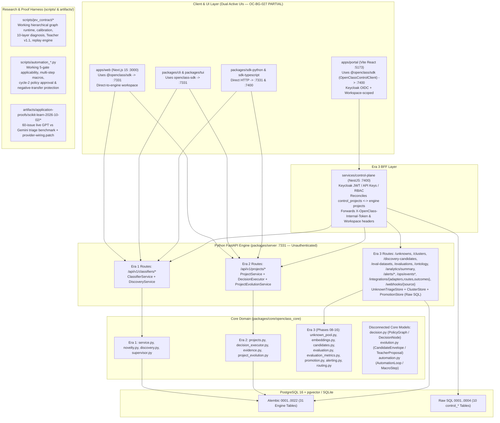

# 01 — Current System Map & Specification Reconciliation

> **Owner:** Abdelhamid Khaled (`AbdelhamidKhald`)  
> **Repository:** `https://github.com/yassincodes404/OpenClass`  
> **Branch:** `abdelhamid-khaled/fix/workspace-isolation-and-checkpoint-cas` (Reconciled through PRs #27–#55)  
> **Scope:** Complete architectural map, ownership boundaries, runtime dataflows, and 3-era specification reconciliation.

---

## 1. Executive Architectural Diagnosis: Three Split-Brain Eras in One Checkout

Inspection of the repository reveals that `OpenClass` is not a single uniform v0.0.1 system. Instead, **three distinct architectural eras coexist in the same checkout**, reconciled across PRs #27–#55 while preserving honest `PARTIAL` boundaries where legacy Era 1 surfaces or dual UIs remain separate:

### 1.1 The Three Eras Defined

| Era                                                                                                          | Governing Documents                                                                                                                                                           | Primary Code Surfaces                                                                                                                                                                                                                                                                                                                                                                                                 | Primary Abstractions                                                                                                                                                                                                                  | Current Operational Reality                                                                                                                                                                                                                                                                                                                                                                                                                                                                                                                                                         |
| :----------------------------------------------------------------------------------------------------------- | :---------------------------------------------------------------------------------------------------------------------------------------------------------------------------- | :-------------------------------------------------------------------------------------------------------------------------------------------------------------------------------------------------------------------------------------------------------------------------------------------------------------------------------------------------------------------------------------------------------------------- | :------------------------------------------------------------------------------------------------------------------------------------------------------------------------------------------------------------------------------------ | :---------------------------------------------------------------------------------------------------------------------------------------------------------------------------------------------------------------------------------------------------------------------------------------------------------------------------------------------------------------------------------------------------------------------------------------------------------------------------------------------------------------------------------------------------------------------------------- |
| **Era 1: Genesis Classifier (`v0.0.1`)**                                                                     | `AGENTS.md`, `docs/architecture/SPECIFICATION.md`, `docs/architecture/genesis.md`, `docs/contributing/tickets.md` (`OC-001`..`OC-032`)                                        | `packages/core/openclass_core/{models,service,novelty,supervisor,discovery}.py`, `packages/server/openclass_server/api/{classifiers,reviews,discovery}.py`, `apps/web/app/page.tsx`                                                                                                                                                                                                                                   | `Classifier`, `OntologyVersion`, `OntologyClass`, `Observation`, `ClassificationRun`, `UnknownEvent`, `CandidateClass`                                                                                                                | Working single-label classifier with `UNKNOWN`, advisory `Supervisor` review (`mock` only by default), candidate discovery (`mock`/`glm`), and append-only ontology snapshots. Replay evaluation (`OC-008`) and candidate approval (`OC-009`) on Track 1 (`classifiers.py`) remain hard-blocked with `409 evaluation_unavailable`.                                                                                                                                                                                                                                                  |
| **Era 2: Project Decision Engine & Jev/Automation Research (`OC-033`)**                                      | `docs/contributing/tickets.md` (`OC-033`), `docs/architecture/jev-native-decision-model.md`, `docs/architecture/teacher-protocol-v1.1.md`, `docs/guides/automation-proof2.md` | `packages/core/openclass_core/{projects,decision_executor,evidence,project_evolution,integrations,analytics}.py`, `apps/web/app/projects/**`, `scripts/jev_contract/**`, `scripts/automation_*.py`                                                                                                                                                                                                                    | `Project`, `RawEvent`, `DecisionService`, `DecisionRun`, `EvidenceItem`, `EvidenceCase`, `ChoiceCandidate`, plus disconnected `PolicyGraph` (`decision.py`), `CandidateEnvelope` (`evolution.py`), `AutomationLoop` (`automation.py`) | Flat single-node `DecisionService` works in `apps/web` and `packages/server`, and supports `ChoiceCandidate` proposals (`project_evolution.py`), while evaluation and promotion on Track 2 (`/candidates/{cid}/evaluate` and `/promote`) remain hard-blocked with `409 Conflict`. Multi-node `PolicyGraph` (`decision.py`), `CandidateEnvelope` (`evolution.py`), and `AutomationLoop` (`automation.py`) remain **100% disconnected** from server persistence and HTTP APIs, while their working implementations live inside `scripts/jev_contract/` and `scripts/automation_*.py`. |
| **Era 3: Enterprise Portal, Control Plane & Application Proof Program (`Phase 01`..`16` + `OC-034`..`039`)** | `docs/OpenClass_Product_Experience_Platform_Spec.md`, `docs/phases/phase-01..20`, `docs/architecture/application-proof-program.md`, `docs/implementation-phases/01..10`       | `apps/portal/src/**` (Vite `:5173`), `services/control-plane/src/**` (NestJS `:7400`), `packages/core/openclass_core/{unknown_pool,embeddings,candidates,evaluation,evaluation_metrics,promotion,alerting,routing}.py`, `packages/server/openclass_server/api/{unknowns,clusters,candidates,evaluations,promotions,operations,support,providers}.py`, `persistence/{unknown_triage,cluster_store,promotion_store}.py` | `Workspace`, `ControlProject`, `UnknownTriage`, `UnknownCluster`, `DiscoveryCandidate`, `EvaluationSet`, `EvaluationExample`, `AlertRule`, `RoutingRule`                                                                              | `feat/portal-phase-17` (`3ab10ea`) implemented Phases 01–16 across `apps/portal`, `services/control-plane`, and engine migrations `0011`..`0022` (31 engine tables total), while `oc-034-ci-baseline` (`ef525ea`) repaired CI (`c6545bf`, run `37051177668`), added the 60-issue `scikit-learn-2026-10-02` live benchmark (`REPORT.md` + unmerged `provider-wiring.patch`), and superseded Phases 17–20 with `docs/architecture/application-proof-program.md` (`OC-034`..`OC-039`) and `docs/implementation-phases/01..10`.                                                         |

---

## 2. Package & Service Ownership Inventory

### 2.1 Python Workspace (`pyproject.toml` + `uv.lock`)

| Package / Directory                                | Role & Intended Boundary                                                                                                                          | Actual Key Modules                                                                                                                                                                                                                                                                                                                                                                                                                                                                                      | Architectural Boundary Violations & Gaps                                                                                                                                                                                                                                                                                                                                                                                                                                                                                                                                                                                                                                   |
| :------------------------------------------------- | :------------------------------------------------------------------------------------------------------------------------------------------------ | :------------------------------------------------------------------------------------------------------------------------------------------------------------------------------------------------------------------------------------------------------------------------------------------------------------------------------------------------------------------------------------------------------------------------------------------------------------------------------------------------------ | :------------------------------------------------------------------------------------------------------------------------------------------------------------------------------------------------------------------------------------------------------------------------------------------------------------------------------------------------------------------------------------------------------------------------------------------------------------------------------------------------------------------------------------------------------------------------------------------------------------------------------------------------------------------------- |
| `packages/core/openclass_core`                     | Pure domain models, ports, and deterministic domain services. Must not import server, adapters, SDKs, or UI.                                      | `models.py`, `service.py`, `novelty.py`, `supervisor.py`, `discovery.py`, `projects.py`, `decision.py`, `decision_executor.py`, `evidence.py`, `evolution.py`, `project_evolution.py`, `automation.py`, `embeddings.py`, `clustering.py`, `unknown_pool.py`, `candidates.py`, `evaluation.py`, `evaluation_metrics.py`, `promotion.py`, `alerting.py`, `routing.py`, `integrations.py`, `analytics.py`, `providers.py`, `repositories.py`                                                               | Clean of upward imports (`test_boundaries.py`), **but** suffers severe internal duplication: 3 decision models (`ClassificationService`, `DecisionService`, `PolicyGraph`), 4 candidate models (`Candidate`, `ChoiceCandidate`, `DiscoveryCandidate`, `CandidateEnvelope`), and hardcoded provider names (`"laya"`, `"jev"`) inside `DecisionExecutor._supervise` (`decision_executor.py:169-197`).                                                                                                                                                                                                                                                                        |
| `packages/server/openclass_server`                 | FastAPI HTTP boundary, SQLAlchemy persistence, Alembic migrations (`0001`..`0022`, 31 tables), rate limiting, redaction, and runtime composition. | `main.py`, `settings.py`, `provider_config.py`, `automation_executor.py`, `integration_adapters.py`, `embeddings_local.py`, `rate_limit.py`, `redaction.py`, `security.py`, `api/{classifiers,projects,decisions,evidence,evolution,integrations,providers,system,unknowns,clusters,candidates,evaluations,promotions,operations,support}.py`, `persistence/{database,tables,mappers,repository,project_repository,integration_repository,idempotency,unknown_triage,cluster_store,promotion_store}.py` | - Completely unauthenticated (`security.py` is a 17-line secret-scanning helper). - `api/{candidates,clusters,unknowns,evaluations,promotions,operations,support}.py` bypass `openclass_core` repositories and execute raw SQL (`sa.text(...)`) directly inside FastAPI route handlers; the 9 tables in `0017`..`0022` are not even declared in `persistence/tables.py`! - `main.py:200,237` registers `support_router` **twice**. - `UnknownTriageStore.append_audit` (`unknown_triage.py:86-110`) writes malformed JSON (`{"target": ...}`) with 10 uninscribed event types into `audit_events`, crashing `GET /audit` and `GET /summary` with HTTP 400/500. |
| `providers/mock`                                   | Deterministic local simulation for classification, decisions, discovery, diagnosis, and supervision.                                              | `openclass_provider_mock/__init__.py`                                                                                                                                                                                                                                                                                                                                                                                                                                                                   | `MockChoiceTeacher` (`project_evolution.py:47-100`) and `MockClusterDiscoveryProvider` (`candidates.py:49-83`) also live inside `openclass_core`.                                                                                                                                                                                                                                                                                                                                                                                                                                                                                                                          |
| `providers/jev`                                    | Constrained structured JSON decision adapter (`llama.cpp` / OpenAI-compatible HTTP).                                                              | `openclass_provider_jev/__init__.py`                                                                                                                                                                                                                                                                                                                                                                                                                                                                    | Ignores `DecisionService.instructions` and `Observation.metadata`; omits `real_inference: True` and `execution_mode: "api"` metadata keys (`__init__.py:102-120`), causing `DecisionExecutor` to misrecord live runs as `real_inference=False, execution_mode="daemon"`.                                                                                                                                                                                                                                                                                                                                                                                                   |
| `providers/laya`                                   | Local in-process or daemon sub-500ms classifier/choice provider.                                                                                  | `openclass_provider_laya/{__init__,profile,status}.py`                                                                                                                                                                                                                                                                                                                                                                                                                                                  | Regex fallback (`_local_fallback_choice`, `__init__.py:251`) sets `"simulated": False`; `_normalize_response` (`__init__.py:280-287`) silently renormalizes uncalibrated outputs instead of rejecting invalid probability distributions; ignores custom service instructions.                                                                                                                                                                                                                                                                                                                                                                                              |
| `providers/glm`                                    | OpenAI-compatible Teacher, Failure Diagnosis, Discovery, Jev Classifier, and Laya Rerank adapters.                                                | `openclass_provider_glm/{__init__,diagnosis,project_teacher}.py`, `LICENSE` (added in `oc-034-ci-baseline`)                                                                                                                                                                                                                                                                                                                                                                                             | Excluded from `pyproject.toml:42` mypy files list; `OpenAICompatibleDiagnosisProvider` (`diagnosis.py:86-93`) silently coerces invalid LLM diagnosis categories to `ANALYTICAL_GAP`; `project_teacher.py:121-122` leaks raw `str(exc)` in `ProviderError`. Note: `GatewayDecisionProvider`, `GatewayEmbedder`, and `GatewayClusterDiscovery` remain unmerged inside `artifacts/application-proofs/scikit-learn-2026-10-02/provider-wiring.patch`.                                                                                                                                                                                                                          |
| `providers/ollama` & `providers/openai-compatible` | Documented local and cloud provider packages.                                                                                                     | `README.md` only (no `pyproject.toml`, no Python source files).                                                                                                                                                                                                                                                                                                                                                                                                                                         | Placeholder directories only; actual OpenAI-compatible logic lives inside `providers/glm`.                                                                                                                                                                                                                                                                                                                                                                                                                                                                                                                                                                                 |
| `packages/sdk-python`                              | Synchronous/async HTTP SDK for Python consumers and CLI.                                                                                          | `openclass_sdk/__init__.py`                                                                                                                                                                                                                                                                                                                                                                                                                                                                             | Calls non-existent `POST /api/v1/projects/{id}/evidence-cases/{cid}/evidence` (`L466`); sends `note` instead of `rationale` on `transition_evidence` (`L442`); missing all Phase 05–16 routes (`/unknowns`, `/clusters`, `/discovery-candidates`, `/eval-datasets`, `/evaluations`, `/ontology`, `/analytics/summary`, `/alerts/*`, `/ops/events*`, `/integrations/{adapters,routes,outcomes}`, `/webhooks/{source}`).                                                                                                                                                                                                                                                     |
| `packages/cli`                                     | `openclass` Typer CLI (`init`, `serve`, `classify`, `unknowns`, `discover`, `candidates`, `approve`, `ontology`, `export`, `project *`).          | `openclass_cli/main.py`                                                                                                                                                                                                                                                                                                                                                                                                                                                                                 | Only covers 16 server endpoints; lacks commands for decision service creation/execution, evidence triage, diagnosis, evaluation datasets, candidate promotion, and integrations.                                                                                                                                                                                                                                                                                                                                                                                                                                                                                           |
| `packages/tui`                                     | Terminal UI inspector.                                                                                                                            | `packages/tui/README.md` only.                                                                                                                                                                                                                                                                                                                                                                                                                                                                          | Unimplemented placeholder (`OC-011` / `OC-013`).                                                                                                                                                                                                                                                                                                                                                                                                                                                                                                                                                                                                                           |

### 2.2 TypeScript / Node Workspace (`package.json` + `pnpm-workspace.yaml`)

| Package / Directory                                   | Role & Intended Boundary                                 | Actual Key Modules                                                                                                                                                                              | Architectural Boundary Violations & Gaps                                                                                                                                                                                                                                                                                                                                   |
| :---------------------------------------------------- | :------------------------------------------------------- | :---------------------------------------------------------------------------------------------------------------------------------------------------------------------------------------------- | :------------------------------------------------------------------------------------------------------------------------------------------------------------------------------------------------------------------------------------------------------------------------------------------------------------------------------------------------------------------------- |
| `packages/sdk-typescript` (`@openclass/sdk`)          | Typed HTTP client for TypeScript consumers and UIs.      | `src/index.ts`, `src/index.test.ts`                                                                                                                                                             | - `ingestEventsBatch` (`src/index.ts:573`) types return as `Promise<RawEvent[]>` when server returns `{ items: RawEvent[] }`, breaking `apps/web` batch ingestion UI. - `attachEvidenceToCase` (`src/index.ts:800`) hits non-existent `POST .../evidence-cases/{cid}/evidence` (404). - Missing all Phase 05–16 Portal/Engine routes.                              |
| `apps/web` (`@openclass/web`)                         | Next.js 15 App Router workspace (`:3000`).               | `app/page.tsx` (Genesis classifier workbench) + `app/projects/**` (7 project tabs: Overview, Data, Services, Playground, Evolution, Integrations, Analytics).                                   | Uses `@openclass/sdk` directly against `:7331`. Unauthenticated. Broken batch upload message (`data/page.tsx:173,229`) and dead `"Add to case"` action (`evolution/page.tsx:303`) due to SDK/API mismatches.                                                                                                                                                               |
| `apps/portal` (`@openclass/portal`)                   | Vite + React 19 SPA (`:5173`) built for Phases 01–16.    | `src/{portal,api,auth,projects,ingestion-pages,decision-pages,unknown-pages,evaluations-pages,ontology-page,analytics,integrations-page,security-pages}.tsx`, `src/styles.css`                  | - **Direct `AGENTS.md` violation**: `apps/portal/src/api.ts:10-25` uses raw `fetch()` against `:7400` and never imports `@openclass/sdk`. - Operates on Track 3 (`unknown_triage` / `cluster_candidates` / `evaluation_sets` / `service_versions`), completely separate from `apps/web`'s Track 2 (`evidence_items` / `evidence_cases` / `project_choice_candidates`). |
| `services/control-plane` (`@openclass/control-plane`) | NestJS 10 BFF & multi-tenant governance layer (`:7400`). | `src/{auth,workspace,project,security,ingestion,decision,unknown,cluster,candidate,evaluation,promotion,operations,support,portal}.controller.ts`, `src/engine.ts`, `migrations/0001..0004.sql` | - Shares PostgreSQL `public` schema with `packages/server` via raw SQL migrations outside Alembic. - `callerOf(request)` (`ingestion.controller.ts:26-32`) drops `keyProjectId`, breaking all `oc_...` API key calls. - Proxies to `:7331` with zero auth headers or workspace isolation (`engine.ts:274-301`).                                                    |

---

## 3. Specification Authority & Contradiction Matrix

The table below reconciles every major architectural contradiction across the repository's specifications and code:

| ID            | Topic                                | Source A Claim                                                                                                                                                                          | Source B Claim                                                                                                                                                                                           | Actual Code Reality                                                                                                                                                                                                                                                                                                                                                                                                                                                                                                                                                                                                                                                                                                                                                                                                                                                                                                                                                                                                                                                       | Resolution Strategy                                                                                                                                                                                                                                                                                                                   |
| :------------ | :----------------------------------- | :-------------------------------------------------------------------------------------------------------------------------------------------------------------------------------------- | :------------------------------------------------------------------------------------------------------------------------------------------------------------------------------------------------------- | :------------------------------------------------------------------------------------------------------------------------------------------------------------------------------------------------------------------------------------------------------------------------------------------------------------------------------------------------------------------------------------------------------------------------------------------------------------------------------------------------------------------------------------------------------------------------------------------------------------------------------------------------------------------------------------------------------------------------------------------------------------------------------------------------------------------------------------------------------------------------------------------------------------------------------------------------------------------------------------------------------------------------------------------------------------------------ | :------------------------------------------------------------------------------------------------------------------------------------------------------------------------------------------------------------------------------------------------------------------------------------------------------------------------------------ |
| **CONTRA-01** | **Frontend & BFF Stack**             | `docs/architecture/foundation-hardening.md:20-29`: _"Do not introduce NestJS, migrate Next.js to Vite, add Keycloak, or create parallel product surfaces during foundation hardening."_ | `docs/OpenClass_Product_Experience_Platform_Spec.md:145-210` & `docs/phases/phase-01..16`: Mandate Vite `apps/portal` (`:5173`), NestJS `services/control-plane` (`:7400`), and Keycloak OIDC (`:8080`). | **Both stacks exist in the checkout.** Root `package.json:7` sets `"dev": "pnpm --filter @openclass/portal dev"`, while `Makefile:28` runs Playwright against `apps/web` (`:3000`). Projects created in `apps/web`/CLI/SDK do not exist in `control_projects` and are invisible in `apps/portal`. `docs/implementation-phases/README.md` (`phase-0-baseline-and-oc-034.md:20-22`) defers final UI consolidation to Implementation Phase 10.                                                                                                                                                                                                                                                                                                                                                                                                                                                                                                                                                                                                                               | Designate **one canonical product architecture**: unify the engine + control-plane data model (single source of truth for projects/workspaces) and consolidate the capabilities of `apps/portal` and `apps/web` behind `@openclass/sdk`.                                                                                              |
| **CONTRA-02** | **SDK-Only UI Rule**                 | `AGENTS.md:8` & `SPECIFICATION.md:45`: _"SDKs speak HTTP only. UI and CLI use SDKs."_                                                                                                   | `apps/portal/package.json` does not depend on `@openclass/sdk`.                                                                                                                                          | `apps/portal/src/api.ts:10-25` uses raw `fetch()` to call NestJS control-plane endpoints (`:7400`).                                                                                                                                                                                                                                                                                                                                                                                                                                                                                                                                                                                                                                                                                                                                                                                                                                                                                                                                                                       | Extend `@openclass/sdk` to support authenticated workspace/project headers andall Phase 05–16 routes, then replace raw `fetch()` in `apps/portal/src/api.ts` with `@openclass/sdk`.                                                                                                                                                   |
| **CONTRA-03** | **Unknown & Evolution Pipeline**     | `SPECIFICATION.md` & `README.md`: Single governed loop `UNKNOWN → EVIDENCE → DISCOVERY → EVALUATION → HUMAN REVIEW → VERSIONED EVOLUTION`.                                              | `docs/phases/phase-07..14` vs `OC-033` vs `jev-native-decision-model.md`.                                                                                                                                | **Four separate, non-interoperating pipelines** exist in code: 1. Classifier `unknown_events` → `candidates` (`discovery.py`, blocked at HTTP `409`). 2. Project `evidence_items` → `evidence_cases` → `project_choice_candidates` (`project_evolution.py` / `api/evolution.py`, blocked at HTTP `409`). 3. Portal `unknown_triage` → `unknown_clusters` → `cluster_candidates` (`0016`) → `candidate_reviews` (`0017`) → `evaluation_sets`/`evaluation_runs` (`0018`..`0019`) → `service_versions` (`0020`). **Implemented on `feat/portal-phase-17` (`api/{candidates,evaluations,promotions}.py`), but with critical flaws**: `api/evaluations.py:306` hardcodes `MockDecisionProvider()` (`"simulated": True`) instead of running `DecisionExecutor` with the service's configured provider, and `api/promotions.py:148-157` / `persistence/promotion_store.py:160` strips `aliases` when updating `decision_services.payload`! 4. Core `PolicyGraph` → `FailureDiagnosis` → `CandidateEnvelope` (`decision.py` + `evolution.py`, unwired to server). | Unify Tracks 2, 3, and 4 on top of the `0017`..`0020` tables: wire real `DecisionExecutor` (with Teacher disabled) into `api/evaluations.py:306`, preserve `aliases` on `DecisionChoiceSpec` and `promotion_store.py:160`, and synchronize `unknown_triage`, `evidence_items`, `project_choice_candidates`, and `cluster_candidates`. |
| **CONTRA-04** | **Default Decision Provider**        | `.env.example:2` & `settings.py:26`: `OPENCLASS_DECISION_PROVIDER=mock` in `.env.example`, `laya` in `settings.py:26`.                                                                  | `docker-compose.yml` & `.github/workflows/ci.yml`: Previously defaulted to `laya` while `laya` package is not installed in `Dockerfile`.                                                                 | Partially resolved on `oc-034-ci-baseline` (`6f61ce0`, `4bd07f9`, `8fc3507`): `.github/workflows/ci.yml` and `docker-compose.yml` now set `OPENCLASS_DECISION_PROVIDER=mock` in CI/Compose, `provider_config.py:29-50` (`resolve_decision_provider`) now fails closed on unknown provider names, and `test_decision_executor.py` skips in-process Laya checks when `laya` is unavailable. However, `Settings.decision_provider` (`settings.py:26`) still defaults to `"laya"` when instantiated without env vars in local `pytest` (`test_reviews.py:96`).                                                                                                                                                                                                                                                                                                                                                                                                                                                                                                                | Standardize safe local/test fallback or pass `MockDecisionProvider()` in `test_reviews.py:96` and fix Windows 2MB parametrize IDs (`OC-BG-001`).                                                                                                                                                                                      |
| **CONTRA-05** | **Semantic Embeddings & `pgvector`** | `docs/phases/phase-09-embeddings-clustering.md`: Local `sentence-transformers` (`all-MiniLM-L6-v2`) or OpenAI-compatible embeddings + `pgvector` cosine similarity search.              | `0001_genesis.py:17` & `main.py:172-177`: Require PostgreSQL `vector` extension for `/health/ready`.                                                                                                     | `embeddings_local.py:18-45` uses a deterministic MD5 token hash (`HashLexicalEmbedder`) hardcoded in `api/clusters.py:35`; `SentenceTransformerEmbedder` (`L48-65`) is synchronous and unwired; `0015_embeddings_clusters.py:23` stores vectors in `sa.JSON()`, never using `pgvector`. Real `GatewayEmbedder` exists only in the unmerged `artifacts/application-proofs/scikit-learn-2026-10-02/provider-wiring.patch`.                                                                                                                                                                                                                                                                                                                                                                                                                                                                                                                                                                                                                                                  | Merge and harden `GatewayEmbedder` / `OpenAICompatibleEmbedder` + async `SentenceTransformerEmbedder`, cache embeddings in `ClusterStore`, and use `pgvector` on PostgreSQL (`OC-BG-022`).                                                                                                                                            |
| **CONTRA-06** | **Package Manager & Build Commands** | `AGENTS.md:20` & `README.md:94`: Mention `npm run build` / `npm ci`.                                                                                                                    | `package.json` & `pnpm-workspace.yaml`: Use `pnpm` workspace protocol (`workspace:*`).                                                                                                                   | **Resolved in CI and `Makefile` by `oc-034-ci-baseline` (`6f61ce0`, `dbb0ab8`)**: `.github/workflows/ci.yml`, `.github/workflows/artifacts.yml`, and `Makefile` now use `pnpm` (`packageManager: "pnpm@11.24.0"`), and `providers/glm/LICENSE` was added (`4bd07f9`) so `scripts/release.py` passes.                                                                                                                                                                                                                                                                                                                                                                                                                                                                                                                                                                                                                                                                                                                                                                      | Keep `pnpm` canonical across all workflows and developer docs.                                                                                                                                                                                                                                                                        |

---

## 4. Ticket (`OC-001`..`OC-045`) & Phase (`Phase 01`..`20` + Implementation Phases `01`..`10`) Audit (Reconciled Through PRs #51–#55)

### 4.1 Ticket Status Audit (`docs/contributing/tickets.md`)

| Ticket Range         | Title / Domain                                                                                                            | Claimed Status in Docs                     | True Verified Status in Code (After PRs #51–#55)                                                                                     | Evidence                                                                                                                                                                                                                                                                                                                                                                                                                                                                                                                                                                                                                                                                                                                                                                                       |
| :------------------- | :------------------------------------------------------------------------------------------------------------------------ | :----------------------------------------- | :----------------------------------------------------------------------------------------------------------------------------------- | :--------------------------------------------------------------------------------------------------------------------------------------------------------------------------------------------------------------------------------------------------------------------------------------------------------------------------------------------------------------------------------------------------------------------------------------------------------------------------------------------------------------------------------------------------------------------------------------------------------------------------------------------------------------------------------------------------------------------------------------------------------------------------------------------- |
| **OC-001 .. OC-006** | Core Models, Novelty, FastAPI Server, SQLite/PG Persistence, Mock/Jev/Laya/Gateway Adapters, Embeddings                   | Foundation Complete                        | **Implemented & Verified (`OC-005` / `OC-BG-022` `PARTIAL` for `pgvector` indexing)**                                                | `packages/core/openclass_core/{models,service,novelty,supervisor}.py`, `providers/{mock,jev,laya,glm,ollama,openai-compatible}`. `GatewayEmbedder` (`text-embedding-3-small`) + `ClusterStore.get_cached_embeddings`/`store_embedding` (`(run_id, model)` in `embeddings`) cache + greedy cosine clustering implemented; `ClusterStore` stores vectors as JSON strings rather than `pgvector` cosine distance indexing on PostgreSQL (`OC-BG-022`: `PARTIAL`).                                                                                                                                                                                                                                                                                                                                 |
| **OC-007**           | Discovery Proposal Generation & Candidate Lifecycle                                                                       | Implemented (Phase 10–11)                  | **Partially Implemented (`OC-BG-008` `VERIFIED`; `OC-BG-014` & `OC-BG-021` `PARTIAL`)**                                              | Non-destructive re-clustering (`0023`, `OC-BG-008`: `VERIFIED`), `unknown_triage` ↔ `evidence_items` sync, and `GatewayClusterDiscovery` / `OpenAICompatibleChoiceTeacher` wiring are active on Tracks 2 & 3 (`candidates` in `0003`, `project_choice_candidates` in `0007`, and `cluster_candidates` in `0016` remain separate tables and `ProposalKind` in `project_evolution.py:22-25` only defines `NEW_CHOICE`, `EXISTING_CHOICE`, and `INSUFFICIENT_EVIDENCE`: `OC-BG-014` `PARTIAL`), while `openclass_core.evolution.apply_candidate` is unit-tested (`OC-BG-021`: `PARTIAL`).                                                                                                                                                                                                         |
| **OC-008**           | Verified Datasets & Replay Evaluation Engine                                                                              | Implemented on Project Tracks 2 & 3        | **Partially Implemented (`OC-BG-011` & `OC-BG-040` `VERIFIED`; `OC-BG-012` `PARTIAL`)**                                              | Enforces strictly disjoint discovery/dev/regression/holdout datasets (`assert_strictly_disjoint_datasets`), server-side discovery-to-holdout leakage rejection (`409`), `label_source="prediction"` rejection (`422`), and real `DecisionExecutor` replay (`Teacher` disabled) in `api/evaluations.py` and `api/evolution.py`. Core `ProjectEvolutionService.evaluate` (`project_evolution.py:217`) and `DiscoveryService.evaluate` (`discovery.py:76`) still raise `ConflictError` (`409`), and per-example replay predictions are stored in `evaluation_runs.metrics` JSON (`0019_evaluation_runs.py`, `metrics["item_results"]`) rather than a separate normalized `evaluation_predictions` SQL table (`OC-BG-012`: `PARTIAL`).                                                             |
| **OC-009**           | Semantic Event Log & Safe Ontology Promotion                                                                              | Implemented on Project Tracks 2 & 3        | **Partially Implemented (`OC-BG-010` `VERIFIED`; `OC-BG-013`, `OC-BG-014`, `OC-BG-036` `PARTIAL`)**                                  | `promotions.py` and `api/evolution.py` enforce `overall_passed is True`, `zero_regressions`, `holdout_examples >= 1`, `SELECT ... FOR UPDATE`, and alias/key collision rejection (`409`) on `DecisionService` versions (`0020_service_versions`), creating `ServiceVersionRow` (`vN+1`) and auto-resolving linked `evidence_items` and `unknown_triage`, while legacy Track 1 `DiscoveryService.approve` (`0001_genesis` `Classifier`) and `ProjectEvolutionService.promote` (`project_evolution.py:221`) remain fail-closed (`409`, `OC-BG-013`), and cohort drift / auto-rollback is not wired (`OC-BG-036`).                                                                                                                                                                                |
| **OC-010 .. OC-012** | Public Protocol, Python/TS SDKs, CLI, TUI, Web/Portal Discovery Workspaces                                                | Implemented (`OC-BG-028` / `OC-BG-027`)    | **Implemented (`OC-BG-007`, `OC-BG-028`, `OC-BG-038` `VERIFIED`; `OC-BG-027` & `OC-BG-033` `PARTIAL`)**                              | Full Phase 05–16 endpoint parity across `openclass-sdk`, `@openclass/sdk` (including `OpenClassControlClient` & `ControlApiError` in PR #53), `openclass-cli`, and `openclass-tui`. `apps/portal` is 100% wired through `@openclass/sdk` (`test_portal_uses_sdk_without_raw_fetch`), while both `apps/web` and `apps/portal` remain active (`OC-BG-027`: `PARTIAL`).                                                                                                                                                                                                                                                                                                                                                                                                                           |
| **OC-013 .. OC-015** | Full No-Key Demo, Release Gates, Controlled Auto-Promotion                                                                | Planned / Deferred                         | **Experimental / Deferred (`OC-BG-034` & `OC-BG-036` `PARTIAL`)**                                                                    | Offline deterministic + live Vercel AI Gateway closed-loop evolution proofs verified in PR #54 (`OC-BG-040`); `OC-015` remains deferred beyond `v0.1`.                                                                                                                                                                                                                                                                                                                                                                                                                                                                                                                                                                                                                                         |
| **OC-016 .. OC-020** | Supervisor Review Foundation, Versioned `DecisionSpec`, Supervisor Providers, AI Management Chat, Continuous Audit Policy | `OC-016`–`018` Implemented; `019` Planned  | **Implemented (`OC-016`–`OC-017` `VERIFIED`, `OC-018` / `OC-BG-020` `PARTIAL`) / Planned (`OC-019`–`OC-020`)**                       | `0002_supervisor_reviews.py`, `0024_decision_run_version_lineage.py` (`decision_service_version_id` and `service_hash`), and `OpenAICompatibleSupervisorProvider` (`glm`, `openai-compatible`, `ollama`, `gateway`) implemented; automatic post-run supervision triggers (`review_on_low_margin`, `sample_rate`) in `ProjectService.record_decision_run` are not implemented (`OC-BG-020`: `PARTIAL`).                                                                                                                                                                                                                                                                                                                                                                                         |
| **OC-021 .. OC-032** | Jev Contract v2.1, Calibration, Hierarchical Graph, Teacher v1.1, Automation Proofs #2 & #2B                              | Research Complete / Graduated              | **Partially Graduated to Core (`OC-BG-005`, `006`, `015`, `019`, `035` `VERIFIED`; `OC-BG-016`, `017`, `018`, `021` `PARTIAL`)**     | Multi-node `DecisionExecutor` with durable checkpoints & atomic CAS claiming (`0026` + `0027`, PRs #52 & #55) and `SafeSandboxExecutor` (`OC-BG-019`) are `VERIFIED`. `compile_event_state` (`decision_executor.py:37-58`) lacks a standalone `StateCompilerPort`, `DecisionServiceNode` `required_state_fields`/`preconditions`, and `0028_state_schemas.py` (`OC-BG-016`: `PARTIAL`); `DecisionExecutor._supervise` (`decision_executor.py:831-885`) retains `laya`/`jev` fallback branches (`OC-BG-017`: `PARTIAL`); `ApplicabilitySpec`/`applicable` (`scripts/automation_applicability.py`) and 5-gate `create_policy_v2` (`scripts/automation_policy_approval.py`) remain in `scripts/` (`OC-BG-018`: `PARTIAL`); and `apply_candidate` is in `openclass_core` (`OC-BG-021`: `PARTIAL`). |
| **OC-033**           | Foundation Structure & Authenticated Ingestion                                                                            | Implemented Locally                        | **Implemented & Verified (`OC-BG-003`, `004`, `005`, `023`, `031` `VERIFIED`; `OC-BG-024`, `025`, `026` `PARTIAL`)**                 | API key scope/project propagation (`OC-BG-003`), SSRF protection (`OC-BG-004`), instruction propagation (`OC-BG-005`), internal token auth + workspace ownership (`0027`, `OC-BG-023`), and redaction/rate-limit/prompt guards (`OC-BG-031`) are `VERIFIED`; Control-Plane `idempotency.service.ts` (`OC-BG-024`), Unit-of-Work sessions / `UNIQUE(decision_run_id)` (`OC-BG-025`), and `control_*` migration runner/triggers (`OC-BG-026`) remain `PARTIAL`.                                                                                                                                                                                                                                                                                                                                  |
| **OC-034**           | Restore Target-Branch CI Baseline                                                                                         | CI Green (PR #29, PR #51)                  | **Implemented & Verified (`OC-BG-001` & `OC-BG-039` `VERIFIED`)**                                                                    | Restored 100% green GitHub Actions CI (`python`, `web`, `compose`, `security`), fixed Windows/Linux `pytest` failures, deduplicated `support_router`, widened PostgreSQL `alembic_version.version_num` to `VARCHAR(128)`, and isolated offline tests from ambient `.env` keys (`585+ passed, 0 failed`).                                                                                                                                                                                                                                                                                                                                                                                                                                                                                       |
| **OC-035**           | Versioned Transition, Execution & Verification Vertical                                                                   | Implemented (`0026`+`0027`, PRs #52 & #55) | **Implemented for Multi-Node Graph Checkpoints & CAS (`OC-BG-009`, `015`, `019`, `035`, `044`: `VERIFIED`; `016`–`018`: `PARTIAL`)** | Added `0026_decision_run_checkpoints.py` and `0027_workspace_isolation_and_checkpoint_claims.py`, supervision pause gates, operator permission checks (`403`), atomic CAS checkpoint claiming before `DecisionExecutor.resume` with stale-claim crash recovery, version conflict detection (`409`) + pinned snapshot execution, and lifecycle-based cancellation.                                                                                                                                                                                                                                                                                                                                                                                                                              |
| **OC-036**           | Shared Integration Manifests & Generic Adapters                                                                           | Partially Implemented (`OC-BG-032`)        | **Partially Implemented (`OC-BG-024` & `OC-BG-032` `PARTIAL`)**                                                                      | `HTTPIntegrationProbe` actively probes REST, Webhook, MCP (JSON-RPC `tools/list`), Provider, and Database endpoints with SSRF protection, and `support.py` enforces idempotent `RouteOutcome` evaluation (`delivery_mode="simulated"`), without a transactional `outbound_deliveries` outbox or vendor HMAC normalizers (`OC-BG-032`: `PARTIAL`).                                                                                                                                                                                                                                                                                                                                                                                                                                              |
| **OC-037**           | Persisted Application Proof Reports                                                                                       | Partially Implemented (`OC-BG-040`)        | **Implemented for Closed-Loop Proof & Operations (`OC-BG-040` & `OC-BG-043` `VERIFIED`; `OC-BG-036` `PARTIAL`)**                     | Disjoint 7-day window comparison (`[two_weeks_ago, week_ago)` vs `[week_ago, now)` in `OC-BG-043`) and offline + live Vercel AI Gateway closed-loop evolution proof (`OC-BG-040`) verified.                                                                                                                                                                                                                                                                                                                                                                                                                                                                                                                                                                                                    |
| **OC-038**           | Customer & Developer Operations Proofs                                                                                    | Verified Closed-Loop Proof (PR #54)        | **Implemented & Verified (`OC-BG-040` `VERIFIED`; `OC-BG-029` & `OC-BG-034` `PARTIAL`)**                                             | Proved both offline deterministic and live Vercel AI Gateway (`OPENCLASS_RUN_LIVE_TESTS=1`) end-to-end closed-loop evolution with strictly disjoint discovery/dev/regression/holdout datasets (`assert_strictly_disjoint_datasets`), leakage rejection (`409`), prediction-label rejection (`422`), collision rejection (`409`), and regressive candidate rejection.                                                                                                                                                                                                                                                                                                                                                                                                                           |
| **OC-039**           | Smart-Home & Robot Simulator Proofs; Cross-Domain Comparison                                                              | Planned (P2)                               | **Planned**                                                                                                                          | Scoped in `tickets.md:305-317`.                                                                                                                                                                                                                                                                                                                                                                                                                                                                                                                                                                                                                                                                                                                                                                |
| **OC-040 .. OC-045** | Additional Remediation Tickets (`OC-BG-039`..`OC-BG-044`, PRs #29–#55)                                                    | Implemented & Verified (PRs #29–#55)       | **Implemented & Verified (`OC-BG-039`..`OC-BG-044` `VERIFIED`)**                                                                     | Covers `support_router` deduplication, ambient `.env` test isolation & `alembic_version` widening (`OC-040`/`OC-BG-039`), strictly disjoint dataset leakage/collision guards & live E2E proof (`OC-041`/`OC-BG-040`), `openclass_provider_glm.gateway` providers (`OC-042`/`OC-BG-041`), Control-Plane `5mb` limit + Portal offline `keycloak.init` + `deriveScenarioDistribution` in `apps/portal/src/open-world-stage.tsx` + chunk splitting (`OC-043`/`OC-BG-042`), disjoint 7-day ops window (`OC-044`/`OC-BG-043`), and end-to-end workspace ownership + atomic CAS checkpoint claiming (`0027`, `OC-045`/`OC-BG-044`).                                                                                                                                                                   |

### 4.2 Portal Phase Audit (`docs/phases/phase-01..20` & `docs/implementation-phases/01..10`)

> **Note on Roadmap Governance (`docs/phases/README.md:3-8`):** On 2026-10-02, the founder-authorized [Application Proof Program](../architecture/application-proof-program.md) and its [10-Phase Implementation Roadmap](../implementation-phases/README.md) superseded the remaining SaaS-first sequencing of `docs/phases/phase-17..20`. Across PRs #27–#55, Portal Phases 01–16 and engine migrations `0001`..`0027` were hardened and reconciled as documented in [`06-verification-matrix.md`](./06-verification-matrix.md).
