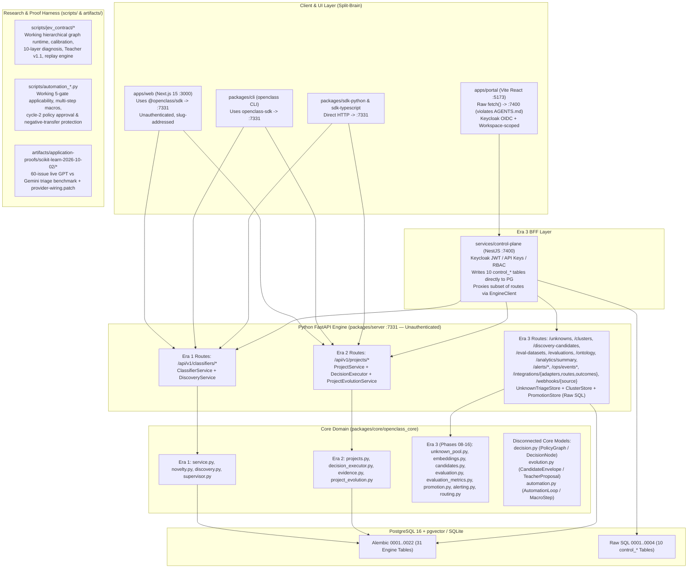

# 01 — Current System Map & Specification Reconciliation

> **Owner:** Abdelhamid Khaled (`AbdelhamidKhald`)  
> **Repository:** `https://github.com/yassincodes404/OpenClass`  
> **Branch:** `abdelhamid-khaled/docs/agentic-harness-audit`  
> **Scope:** Complete architectural map, ownership boundaries, runtime dataflows, and 3-era specification reconciliation.

---

## 1. Executive Architectural Diagnosis: Three Split-Brain Eras in One Checkout

Inspection of the repository reveals that `OpenClass` is not a single uniform v0.0.1 system. Instead, **three distinct architectural eras coexist in the same checkout**, partially overlapping and partially contradicting one another:

### 1.1 The Three Eras Defined

| Era                                                                                                          | Governing Documents                                                                                                                                                           | Primary Code Surfaces                                                                                                                                                                                                                                                                                                                                                                                                 | Primary Abstractions                                                                                                                                                                                                                  | Current Operational Reality                                                                                                                                                                                                                                                                                                                                                                                                                                                                                                                                                         |
| :----------------------------------------------------------------------------------------------------------- | :---------------------------------------------------------------------------------------------------------------------------------------------------------------------------- | :-------------------------------------------------------------------------------------------------------------------------------------------------------------------------------------------------------------------------------------------------------------------------------------------------------------------------------------------------------------------------------------------------------------------- | :------------------------------------------------------------------------------------------------------------------------------------------------------------------------------------------------------------------------------------ | :---------------------------------------------------------------------------------------------------------------------------------------------------------------------------------------------------------------------------------------------------------------------------------------------------------------------------------------------------------------------------------------------------------------------------------------------------------------------------------------------------------------------------------------------------------------------------------- |
| **Era 1: Genesis Classifier (`v0.0.1`)**                                                                     | `AGENTS.md`, `docs/architecture/SPECIFICATION.md`, `docs/architecture/genesis.md`, `docs/contributing/tickets.md` (`OC-001`..`OC-032`)                                        | `packages/core/openclass_core/{models,service,novelty,supervisor,discovery}.py`, `packages/server/openclass_server/api/{classifiers,reviews,discovery}.py`, `apps/web/app/page.tsx`                                                                                                                                                                                                                                   | `Classifier`, `OntologyVersion`, `OntologyClass`, `Observation`, `ClassificationRun`, `UnknownEvent`, `CandidateClass`                                                                                                                | Working single-label classifier with `UNKNOWN`, advisory `Supervisor` review (`mock` only by default), candidate discovery (`mock`/`glm`), and append-only ontology snapshots. Replay evaluation (`OC-008`) and candidate approval (`OC-009`) on Track 1 (`classifiers.py`) remain hard-blocked with `409 evaluation_unavailable`.                                                                                                                                                                                                                                                  |
| **Era 2: Project Decision Engine & Jev/Automation Research (`OC-033`)**                                      | `docs/contributing/tickets.md` (`OC-033`), `docs/architecture/jev-native-decision-model.md`, `docs/architecture/teacher-protocol-v1.1.md`, `docs/guides/automation-proof2.md` | `packages/core/openclass_core/{projects,decision_executor,evidence,project_evolution,integrations,analytics}.py`, `apps/web/app/projects/**`, `scripts/jev_contract/**`, `scripts/automation_*.py`                                                                                                                                                                                                                    | `Project`, `RawEvent`, `DecisionService`, `DecisionRun`, `EvidenceItem`, `EvidenceCase`, `ChoiceCandidate`, plus disconnected `PolicyGraph` (`decision.py`), `CandidateEnvelope` (`evolution.py`), `AutomationLoop` (`automation.py`) | Flat single-node `DecisionService` works in `apps/web` and `packages/server`, and supports `ChoiceCandidate` proposals (`project_evolution.py`), while evaluation and promotion on Track 2 (`/candidates/{cid}/evaluate` and `/promote`) remain hard-blocked with `409 Conflict`. Multi-node `PolicyGraph` (`decision.py`), `CandidateEnvelope` (`evolution.py`), and `AutomationLoop` (`automation.py`) remain **100% disconnected** from server persistence and HTTP APIs, while their working implementations live inside `scripts/jev_contract/` and `scripts/automation_*.py`. |
| **Era 3: Enterprise Portal, Control Plane & Application Proof Program (`Phase 01`..`16` + `OC-034`..`039`)** | `docs/OpenClass_Product_Experience_Platform_Spec.md`, `docs/phases/phase-01..20`, `docs/architecture/application-proof-program.md`, `docs/implementation-phases/01..10`       | `apps/portal/src/**` (Vite `:5173`), `services/control-plane/src/**` (NestJS `:7400`), `packages/core/openclass_core/{unknown_pool,embeddings,candidates,evaluation,evaluation_metrics,promotion,alerting,routing}.py`, `packages/server/openclass_server/api/{unknowns,clusters,candidates,evaluations,promotions,operations,support,providers}.py`, `persistence/{unknown_triage,cluster_store,promotion_store}.py` | `Workspace`, `ControlProject`, `UnknownTriage`, `UnknownCluster`, `DiscoveryCandidate`, `EvaluationSet`, `EvaluationExample`, `AlertRule`, `RoutingRule`                                                                              | `feat/portal-phase-17` (`3ab10ea`) implemented Phases 01–16 across `apps/portal`, `services/control-plane`, and engine migrations `0011`..`0022` (31 engine tables total), while `oc-034-ci-baseline` (`ef525ea`) repaired CI (`c6545bf`, run `37051177668`), added the 60-issue `scikit-learn-2026-10-02` live benchmark (`REPORT.md` + unmerged `provider-wiring.patch`), and superseded Phases 17–20 with `docs/architecture/application-proof-program.md` (`OC-034`..`OC-039`) and `docs/implementation-phases/01..10`.                                                         |

---

## 2. Package & Service Ownership Inventory

### 2.1 Python Workspace (`pyproject.toml` + `uv.lock`)

| Package / Directory                                | Role & Intended Boundary                                                                                                                          | Actual Key Modules                                                                                                                                                                                                                                                                                                                                                                                                                                                                                      | Architectural Boundary Violations & Gaps                                                                                                                                                                                                                                                                                                                                                                                                                                                                                                                                                                                                                                   |
| :------------------------------------------------- | :------------------------------------------------------------------------------------------------------------------------------------------------ | :------------------------------------------------------------------------------------------------------------------------------------------------------------------------------------------------------------------------------------------------------------------------------------------------------------------------------------------------------------------------------------------------------------------------------------------------------------------------------------------------------ | :------------------------------------------------------------------------------------------------------------------------------------------------------------------------------------------------------------------------------------------------------------------------------------------------------------------------------------------------------------------------------------------------------------------------------------------------------------------------------------------------------------------------------------------------------------------------------------------------------------------------------------------------------------------------- |
| `packages/core/openclass_core`                     | Pure domain models, ports, and deterministic domain services. Must not import server, adapters, SDKs, or UI.                                      | `models.py`, `service.py`, `novelty.py`, `supervisor.py`, `discovery.py`, `projects.py`, `decision.py`, `decision_executor.py`, `evidence.py`, `evolution.py`, `project_evolution.py`, `automation.py`, `embeddings.py`, `clustering.py`, `unknown_pool.py`, `candidates.py`, `evaluation.py`, `evaluation_metrics.py`, `promotion.py`, `alerting.py`, `routing.py`, `integrations.py`, `analytics.py`, `providers.py`, `repositories.py`                                                               | Clean of upward imports (`test_boundaries.py`), **but** suffers severe internal duplication: 3 decision models (`ClassificationService`, `DecisionService`, `PolicyGraph`), 4 candidate models (`Candidate`, `ChoiceCandidate`, `DiscoveryCandidate`, `CandidateEnvelope`), and hardcoded provider names (`"laya"`, `"jev"`) inside `DecisionExecutor._supervise` (`decision_executor.py:169-197`).                                                                                                                                                                                                                                                                        |
| `packages/server/openclass_server`                 | FastAPI HTTP boundary, SQLAlchemy persistence, Alembic migrations (`0001`..`0022`, 31 tables), rate limiting, redaction, and runtime composition. | `main.py`, `settings.py`, `provider_config.py`, `automation_executor.py`, `integration_adapters.py`, `embeddings_local.py`, `rate_limit.py`, `redaction.py`, `security.py`, `api/{classifiers,projects,decisions,evidence,evolution,integrations,providers,system,unknowns,clusters,candidates,evaluations,promotions,operations,support}.py`, `persistence/{database,tables,mappers,repository,project_repository,integration_repository,idempotency,unknown_triage,cluster_store,promotion_store}.py` | - Completely unauthenticated (`security.py` is a 17-line secret-scanning helper). - `api/{candidates,clusters,unknowns,evaluations,promotions,operations,support}.py` bypass `openclass_core` repositories and execute raw SQL (`sa.text(...)`) directly inside FastAPI route handlers; the 9 tables in `0017`..`0022` are not even declared in `persistence/tables.py`! - `main.py:200,237` registers `support_router` **twice**. - `UnknownTriageStore.append_audit` (`unknown_triage.py:86-110`) writes malformed JSON (`{"target": ...}`) with 10 uninscribed event types into `audit_events`, crashing `GET /audit` and `GET /summary` with HTTP 400/500. |
| `providers/mock`                                   | Deterministic local simulation for classification, decisions, discovery, diagnosis, and supervision.                                              | `openclass_provider_mock/__init__.py`                                                                                                                                                                                                                                                                                                                                                                                                                                                                   | `MockChoiceTeacher` (`project_evolution.py:47-100`) and `MockClusterDiscoveryProvider` (`candidates.py:49-83`) also live inside `openclass_core`.                                                                                                                                                                                                                                                                                                                                                                                                                                                                                                                          |
| `providers/jev`                                    | Constrained structured JSON decision adapter (`llama.cpp` / OpenAI-compatible HTTP).                                                              | `openclass_provider_jev/__init__.py`                                                                                                                                                                                                                                                                                                                                                                                                                                                                    | Ignores `DecisionService.instructions` and `Observation.metadata`; omits `real_inference: True` and `execution_mode: "api"` metadata keys (`__init__.py:102-120`), causing `DecisionExecutor` to misrecord live runs as `real_inference=False, execution_mode="daemon"`.                                                                                                                                                                                                                                                                                                                                                                                                   |
| `providers/laya`                                   | Local in-process or daemon sub-500ms classifier/choice provider.                                                                                  | `openclass_provider_laya/{__init__,profile,status}.py`                                                                                                                                                                                                                                                                                                                                                                                                                                                  | Regex fallback (`_local_fallback_choice`, `__init__.py:251`) sets `"simulated": False`; `_normalize_response` (`__init__.py:280-287`) silently renormalizes uncalibrated outputs instead of rejecting invalid probability distributions; ignores custom service instructions.                                                                                                                                                                                                                                                                                                                                                                                              |
| `providers/glm`                                    | OpenAI-compatible Teacher, Failure Diagnosis, Discovery, Jev Classifier, and Laya Rerank adapters.                                                | `openclass_provider_glm/{__init__,diagnosis,project_teacher}.py`, `LICENSE` (added in `oc-034-ci-baseline`)                                                                                                                                                                                                                                                                                                                                                                                             | Excluded from `pyproject.toml:42` mypy files list; `OpenAICompatibleDiagnosisProvider` (`diagnosis.py:86-93`) silently coerces invalid LLM diagnosis categories to `ANALYTICAL_GAP`; `project_teacher.py:121-122` leaks raw `str(exc)` in `ProviderError`. Note: `GatewayDecisionProvider`, `GatewayEmbedder`, and `GatewayClusterDiscovery` remain unmerged inside `artifacts/application-proofs/scikit-learn-2026-10-02/provider-wiring.patch`.                                                                                                                                                                                                                          |
| `providers/ollama` & `providers/openai-compatible` | Documented local and cloud provider packages.                                                                                                     | `README.md` only (no `pyproject.toml`, no Python source files).                                                                                                                                                                                                                                                                                                                                                                                                                                         | Placeholder directories only; actual OpenAI-compatible logic lives inside `providers/glm`.                                                                                                                                                                                                                                                                                                                                                                                                                                                                                                                                                                                 |
| `packages/sdk-python`                              | Synchronous/async HTTP SDK for Python consumers and CLI.                                                                                          | `openclass_sdk/__init__.py`                                                                                                                                                                                                                                                                                                                                                                                                                                                                             | Calls non-existent `POST /api/v1/projects/{id}/evidence-cases/{cid}/evidence` (`L466`); sends `note` instead of `rationale` on `transition_evidence` (`L442`); missing all Phase 05–16 routes (`/unknowns`, `/clusters`, `/discovery-candidates`, `/eval-datasets`, `/evaluations`, `/ontology`, `/analytics/summary`, `/alerts/*`, `/ops/events*`, `/integrations/{adapters,routes,outcomes}`, `/webhooks/{source}`).                                                                                                                                                                                                                                                     |
| `packages/cli`                                     | `openclass` Typer CLI (`init`, `serve`, `classify`, `unknowns`, `discover`, `candidates`, `approve`, `ontology`, `export`, `project *`).          | `openclass_cli/main.py`                                                                                                                                                                                                                                                                                                                                                                                                                                                                                 | Only covers 16 server endpoints; lacks commands for decision service creation/execution, evidence triage, diagnosis, evaluation datasets, candidate promotion, and integrations.                                                                                                                                                                                                                                                                                                                                                                                                                                                                                           |
| `packages/tui`                                     | Terminal UI inspector.                                                                                                                            | `packages/tui/README.md` only.                                                                                                                                                                                                                                                                                                                                                                                                                                                                          | Unimplemented placeholder (`OC-011` / `OC-013`).                                                                                                                                                                                                                                                                                                                                                                                                                                                                                                                                                                                                                           |

### 2.2 TypeScript / Node Workspace (`package.json` + `pnpm-workspace.yaml`)

| Package / Directory                                   | Role & Intended Boundary                                 | Actual Key Modules                                                                                                                                                                              | Architectural Boundary Violations & Gaps                                                                                                                                                                                                                                                                                                                                   |
| :---------------------------------------------------- | :------------------------------------------------------- | :---------------------------------------------------------------------------------------------------------------------------------------------------------------------------------------------- | :------------------------------------------------------------------------------------------------------------------------------------------------------------------------------------------------------------------------------------------------------------------------------------------------------------------------------------------------------------------------- |
| `packages/sdk-typescript` (`@openclass/sdk`)          | Typed HTTP client for TypeScript consumers and UIs.      | `src/index.ts`, `src/index.test.ts`                                                                                                                                                             | - `ingestEventsBatch` (`src/index.ts:573`) types return as `Promise<RawEvent[]>` when server returns `{ items: RawEvent[] }`, breaking `apps/web` batch ingestion UI. - `attachEvidenceToCase` (`src/index.ts:800`) hits non-existent `POST .../evidence-cases/{cid}/evidence` (404). - Missing all Phase 05–16 Portal/Engine routes.                              |
| `apps/web` (`@openclass/web`)                         | Next.js 15 App Router workspace (`:3000`).               | `app/page.tsx` (Genesis classifier workbench) + `app/projects/**` (7 project tabs: Overview, Data, Services, Playground, Evolution, Integrations, Analytics).                                   | Uses `@openclass/sdk` directly against `:7331`. Unauthenticated. Broken batch upload message (`data/page.tsx:173,229`) and dead `"Add to case"` action (`evolution/page.tsx:303`) due to SDK/API mismatches.                                                                                                                                                               |
| `apps/portal` (`@openclass/portal`)                   | Vite + React 19 SPA (`:5173`) built for Phases 01–16.    | `src/{portal,api,auth,projects,ingestion-pages,decision-pages,unknown-pages,evaluations-pages,ontology-page,analytics,integrations-page,security-pages}.tsx`, `src/styles.css`                  | - **Direct `AGENTS.md` violation**: `apps/portal/src/api.ts:10-25` uses raw `fetch()` against `:7400` and never imports `@openclass/sdk`. - Operates on Track 3 (`unknown_triage` / `cluster_candidates` / `evaluation_sets` / `service_versions`), completely separate from `apps/web`'s Track 2 (`evidence_items` / `evidence_cases` / `project_choice_candidates`). |
| `services/control-plane` (`@openclass/control-plane`) | NestJS 10 BFF & multi-tenant governance layer (`:7400`). | `src/{auth,workspace,project,security,ingestion,decision,unknown,cluster,candidate,evaluation,promotion,operations,support,portal}.controller.ts`, `src/engine.ts`, `migrations/0001..0004.sql` | - Shares PostgreSQL `public` schema with `packages/server` via raw SQL migrations outside Alembic. - `callerOf(request)` (`ingestion.controller.ts:26-32`) drops `keyProjectId`, breaking all `oc_...` API key calls. - Proxies to `:7331` with zero auth headers or workspace isolation (`engine.ts:274-301`).                                                    |

---

## 3. Specification Authority & Contradiction Matrix

The table below reconciles every major architectural contradiction across the repository's specifications and code:

| ID            | Topic                                | Source A Claim                                                                                                                                                                          | Source B Claim                                                                                                                                                                                           | Actual Code Reality                                                                                                                                                                                                                                                                                                                                                                                                                                                                                                                                                                                                                                                                                                                                                                                                                                                                                                                                                                                                                                                       | Resolution Strategy                                                                                                                                                                                                                                                                                                                   |
| :------------ | :----------------------------------- | :-------------------------------------------------------------------------------------------------------------------------------------------------------------------------------------- | :------------------------------------------------------------------------------------------------------------------------------------------------------------------------------------------------------- | :------------------------------------------------------------------------------------------------------------------------------------------------------------------------------------------------------------------------------------------------------------------------------------------------------------------------------------------------------------------------------------------------------------------------------------------------------------------------------------------------------------------------------------------------------------------------------------------------------------------------------------------------------------------------------------------------------------------------------------------------------------------------------------------------------------------------------------------------------------------------------------------------------------------------------------------------------------------------------------------------------------------------------------------------------------------------ | :------------------------------------------------------------------------------------------------------------------------------------------------------------------------------------------------------------------------------------------------------------------------------------------------------------------------------------ |
| **CONTRA-01** | **Frontend & BFF Stack**             | `docs/architecture/foundation-hardening.md:20-29`: _"Do not introduce NestJS, migrate Next.js to Vite, add Keycloak, or create parallel product surfaces during foundation hardening."_ | `docs/OpenClass_Product_Experience_Platform_Spec.md:145-210` & `docs/phases/phase-01..16`: Mandate Vite `apps/portal` (`:5173`), NestJS `services/control-plane` (`:7400`), and Keycloak OIDC (`:8080`). | **Both stacks exist in the checkout.** Root `package.json:7` sets `"dev": "pnpm --filter @openclass/portal dev"`, while `Makefile:28` runs Playwright against `apps/web` (`:3000`). Projects created in `apps/web`/CLI/SDK do not exist in `control_projects` and are invisible in `apps/portal`. `docs/implementation-phases/README.md` (`phase-0-baseline-and-oc-034.md:20-22`) defers final UI consolidation to Implementation Phase 10.                                                                                                                                                                                                                                                                                                                                                                                                                                                                                                                                                                                                                               | Designate **one canonical product architecture**: unify the engine + control-plane data model (single source of truth for projects/workspaces) and consolidate the capabilities of `apps/portal` and `apps/web` behind `@openclass/sdk`.                                                                                              |
| **CONTRA-02** | **SDK-Only UI Rule**                 | `AGENTS.md:8` & `SPECIFICATION.md:45`: _"SDKs speak HTTP only. UI and CLI use SDKs."_                                                                                                   | `apps/portal/package.json` does not depend on `@openclass/sdk`.                                                                                                                                          | `apps/portal/src/api.ts:10-25` uses raw `fetch()` to call NestJS control-plane endpoints (`:7400`).                                                                                                                                                                                                                                                                                                                                                                                                                                                                                                                                                                                                                                                                                                                                                                                                                                                                                                                                                                       | Extend `@openclass/sdk` to support authenticated workspace/project headers andall Phase 05–16 routes, then replace raw `fetch()` in `apps/portal/src/api.ts` with `@openclass/sdk`.                                                                                                                                                   |
| **CONTRA-03** | **Unknown & Evolution Pipeline**     | `SPECIFICATION.md` & `README.md`: Single governed loop `UNKNOWN → EVIDENCE → DISCOVERY → EVALUATION → HUMAN REVIEW → VERSIONED EVOLUTION`.                                              | `docs/phases/phase-07..14` vs `OC-033` vs `jev-native-decision-model.md`.                                                                                                                                | **Four separate, non-interoperating pipelines** exist in code: 1. Classifier `unknown_events` → `candidates` (`discovery.py`, blocked at HTTP `409`). 2. Project `evidence_items` → `evidence_cases` → `project_choice_candidates` (`project_evolution.py` / `api/evolution.py`, blocked at HTTP `409`). 3. Portal `unknown_triage` → `unknown_clusters` → `cluster_candidates` (`0016`) → `candidate_reviews` (`0017`) → `evaluation_sets`/`evaluation_runs` (`0018`..`0019`) → `service_versions` (`0020`). **Implemented on `feat/portal-phase-17` (`api/{candidates,evaluations,promotions}.py`), but with critical flaws**: `api/evaluations.py:306` hardcodes `MockDecisionProvider()` (`"simulated": True`) instead of running `DecisionExecutor` with the service's configured provider, and `api/promotions.py:148-157` / `persistence/promotion_store.py:160` strips `aliases` when updating `decision_services.payload`! 4. Core `PolicyGraph` → `FailureDiagnosis` → `CandidateEnvelope` (`decision.py` + `evolution.py`, unwired to server). | Unify Tracks 2, 3, and 4 on top of the `0017`..`0020` tables: wire real `DecisionExecutor` (with Teacher disabled) into `api/evaluations.py:306`, preserve `aliases` on `DecisionChoiceSpec` and `promotion_store.py:160`, and synchronize `unknown_triage`, `evidence_items`, `project_choice_candidates`, and `cluster_candidates`. |
| **CONTRA-04** | **Default Decision Provider**        | `.env.example:2` & `settings.py:26`: `OPENCLASS_DECISION_PROVIDER=mock` in `.env.example`, `laya` in `settings.py:26`.                                                                  | `docker-compose.yml` & `.github/workflows/ci.yml`: Previously defaulted to `laya` while `laya` package is not installed in `Dockerfile`.                                                                 | Partially resolved on `oc-034-ci-baseline` (`6f61ce0`, `4bd07f9`, `8fc3507`): `.github/workflows/ci.yml` and `docker-compose.yml` now set `OPENCLASS_DECISION_PROVIDER=mock` in CI/Compose, `provider_config.py:29-50` (`resolve_decision_provider`) now fails closed on unknown provider names, and `test_decision_executor.py` skips in-process Laya checks when `laya` is unavailable. However, `Settings.decision_provider` (`settings.py:26`) still defaults to `"laya"` when instantiated without env vars in local `pytest` (`test_reviews.py:96`).                                                                                                                                                                                                                                                                                                                                                                                                                                                                                                                | Standardize safe local/test fallback or pass `MockDecisionProvider()` in `test_reviews.py:96` and fix Windows 2MB parametrize IDs (`OC-BG-001`).                                                                                                                                                                                      |
| **CONTRA-05** | **Semantic Embeddings & `pgvector`** | `docs/phases/phase-09-embeddings-clustering.md`: Local `sentence-transformers` (`all-MiniLM-L6-v2`) or OpenAI-compatible embeddings + `pgvector` cosine similarity search.              | `0001_genesis.py:17` & `main.py:172-177`: Require PostgreSQL `vector` extension for `/health/ready`.                                                                                                     | `embeddings_local.py:18-45` uses a deterministic MD5 token hash (`HashLexicalEmbedder`) hardcoded in `api/clusters.py:35`; `SentenceTransformerEmbedder` (`L48-65`) is synchronous and unwired; `0015_embeddings_clusters.py:23` stores vectors in `sa.JSON()`, never using `pgvector`. Real `GatewayEmbedder` exists only in the unmerged `artifacts/application-proofs/scikit-learn-2026-10-02/provider-wiring.patch`.                                                                                                                                                                                                                                                                                                                                                                                                                                                                                                                                                                                                                                                  | Merge and harden `GatewayEmbedder` / `OpenAICompatibleEmbedder` + async `SentenceTransformerEmbedder`, cache embeddings in `ClusterStore`, and use `pgvector` on PostgreSQL (`OC-BG-022`).                                                                                                                                            |
| **CONTRA-06** | **Package Manager & Build Commands** | `AGENTS.md:20` & `README.md:94`: Mention `npm run build` / `npm ci`.                                                                                                                    | `package.json` & `pnpm-workspace.yaml`: Use `pnpm` workspace protocol (`workspace:*`).                                                                                                                   | **Resolved in CI and `Makefile` by `oc-034-ci-baseline` (`6f61ce0`, `dbb0ab8`)**: `.github/workflows/ci.yml`, `.github/workflows/artifacts.yml`, and `Makefile` now use `pnpm` (`packageManager: "pnpm@11.24.0"`), and `providers/glm/LICENSE` was added (`4bd07f9`) so `scripts/release.py` passes.                                                                                                                                                                                                                                                                                                                                                                                                                                                                                                                                                                                                                                                                                                                                                                      | Keep `pnpm` canonical across all workflows and developer docs.                                                                                                                                                                                                                                                                        |

---

## 4. Ticket (`OC-001`..`OC-039`) & Phase (`Phase 01`..`20` + Implementation Phases `01`..`10`) Audit

### 4.1 Ticket Status Audit (`docs/contributing/tickets.md`)

| Ticket Range         | Title / Domain                                                                                                            | Claimed Status in Docs                                      | True Verified Status in Code                                                                                                                                                                                                                                                                                                                                                    | Evidence                                                                                                                                                                                                                                                                                                         |
| :------------------- | :------------------------------------------------------------------------------------------------------------------------ | :---------------------------------------------------------- | :------------------------------------------------------------------------------------------------------------------------------------------------------------------------------------------------------------------------------------------------------------------------------------------------------------------------------------------------------------------------------ | :--------------------------------------------------------------------------------------------------------------------------------------------------------------------------------------------------------------------------------------------------------------------------------------------------------------- |
| **OC-001 .. OC-006** | Core Models, Novelty, FastAPI Server, SQLite/PG Persistence, Mock/Jev/Laya Adapters, Supervisor                           | Foundation Complete                                         | **Implemented & Verified** (with defects in Jev/Laya provenance & Supervisor wiring)                                                                                                                                                                                                                                                                                            | `packages/core/openclass_core/{models,service,novelty,supervisor}.py`, `providers/{mock,jev,laya}`. Note: `provider_config.py:56-58` only wires `MockSupervisorProvider`.                                                                                                                                        |
| **OC-007**           | Discovery Proposal Generation & Candidate Lifecycle                                                                       | Implemented (Phase 10–11)                                   | **Partially Implemented (Split across 3 tracks)**                                                                                                                                                                                                                                                                                                                               | Track 1 (`discovery.py:25-78`), Track 2 (`project_evolution.py`), and Track 3 (`api/candidates.py` + `0016_cluster_candidates.py` + `0017_candidate_reviews.py`). `api/candidates.py:46` still hardcodes `MockClusterDiscoveryProvider` unless `provider-wiring.patch` is applied.                               |
| **OC-008**           | Verified Datasets & Replay Evaluation Engine                                                                              | Open / Gate (Implemented on Portal Track 3 in Phases 12–13) | **Split / Simulated**: Blocked with `409` in `discovery.py:76-79` and `project_evolution.py:204-206`; **Implemented on Portal Track 3** (`evaluation.py`, `evaluation_metrics.py`, `api/evaluations.py`, `0018_evaluation_sets.py`, `0019_evaluation_runs.py`), **but `api/evaluations.py:306` hardcodes `MockDecisionProvider()` (`simulated: True`)**!                        | `api/evaluations.py:35-424` implements dataset creation, `source != "prediction"` validation, sealing, and baseline-vs-candidate replay with regression gates, but replays against `MockDecisionProvider()` instead of `DecisionExecutor`.                                                                       |
| **OC-009**           | Semantic Event Log & Safe Ontology Promotion                                                                              | Open / Gate (Implemented on Portal Track 3 in Phase 14)     | **Split / Partial**: Blocked with `409` in `discovery.py:69-74` and `project_evolution.py:208-240`; **Implemented on Portal Track 3** (`promotion.py`, `api/promotions.py`, `persistence/promotion_store.py`, `0020_service_versions.py`), **but strips `aliases` from live `decision_services.payload`** (`promotion_store.py:160`) and lacks `SELECT ... FOR UPDATE` locking. | `0020_service_versions.py` adds `service_versions` and `service_ontology_events` with `openclass_immutable` triggers; `api/promotions.py:101-266` implements `/promote`, `/ontology`, `/ontology/diff`, and `/ontology/rollback`.                                                                                |
| **OC-010 .. OC-012** | Public Protocol, Python/TS SDKs, CLI, Web Discovery Workspace                                                             | Foundation Complete / P1                                    | **Partially Implemented (Contract Drift)**                                                                                                                                                                                                                                                                                                                                      | Both SDKs have 404/schema bugs on evidence routes (`sdk-python/__init__.py:466`, `sdk-typescript/src/index.ts:573,800`) and miss all Phase 05–16 routes (`/unknowns`, `/clusters`, `/discovery-candidates`, `/eval-datasets`, `/evaluations`, `/ontology`, `/alerts/*`, `/ops/events*`, `/integrations/routes`). |
| **OC-013 .. OC-015** | Full No-Key Demo, Release Gates, Controlled Auto-Promotion                                                                | Planned / Deferred                                          | **Experimental / Deferred**                                                                                                                                                                                                                                                                                                                                                     | `scripts/seed_portal_phase_01..16.py` exist; `OC-015` is explicitly deferred beyond `v0.1`.                                                                                                                                                                                                                      |
| **OC-016 .. OC-020** | Supervisor Review Foundation, Versioned `DecisionSpec`, Supervisor Providers, AI Management Chat, Continuous Audit Policy | `OC-016` Implemented; `OC-017`..`020` Planned               | **Partially Implemented (`OC-016` Mock-Only; `OC-017`..`020` Absent)**                                                                                                                                                                                                                                                                                                          | `0002_supervisor_reviews.py` & `supervisor.py` implemented (`OC-016`), but `provider_config.py:56-58` only returns `MockSupervisorProvider()`. `DecisionRun` still lacks `decision_service_version_id` (`OC-017`).                                                                                               |
| **OC-021 .. OC-032** | Jev Contract v2.1, Calibration, Hierarchical Graph, Teacher v1.1, Automation Proofs #2 & #2B                              | Research Complete                                           | **Disconnected Core / Script-Only**                                                                                                                                                                                                                                                                                                                                             | Domain types copied into `decision.py`, `evolution.py`, `automation.py`, but runtime execution remains in `scripts/jev_contract/` and `scripts/automation_*.py`.                                                                                                                                                 |
| **OC-033**           | Foundation Structure & Authenticated Ingestion                                                                            | Implemented Locally                                         | **Partially Implemented (Critical Bugs)**                                                                                                                                                                                                                                                                                                                                       | `projects.py`, `decision_executor.py`, `evidence.py`, `project_evolution.py`, `integrations.py`, `0010_webhook_receipts.py`. Suffers from instruction-drop bug (`decision_executor.py:58-85`), single-node execution (`L38-50`), and SSRF (`integration_adapters.py:89-126`).                                    |
| **OC-034**           | Restore Target-Branch CI Baseline                                                                                         | CI Green (`c6545bf`, Run `37051177668`)                     | **Implemented & Verified on `oc-034-ci-baseline` (Local Windows `pytest` caveats remain)**                                                                                                                                                                                                                                                                                      | Fixed `pnpm` in CI/Makefile (`6f61ce0`, `dbb0ab8`), `OPENCLASS_DECISION_PROVIDER=mock` in CI/Compose, `providers/glm/LICENSE` (`4bd07f9`), and fail-closed `resolve_decision_provider()` (`8fc3507`). See `docs/implementation-phases/evidence/phase-0-baseline-and-oc-034.md`.                                  |
| **OC-035**           | Versioned Transition, Execution & Verification Vertical                                                                   | Planned (P0)                                                | **Planned (Maps to `OC-BG-015`, `OC-BG-016`, `OC-BG-018`, `OC-BG-019`)**                                                                                                                                                                                                                                                                                                        | Scoped in `docs/contributing/tickets.md:252-266` and `docs/architecture/application-proof-program.md:55-84`.                                                                                                                                                                                                     |
| **OC-036**           | Shared Integration Manifests & Generic Adapters                                                                           | Planned (P0)                                                | **Planned / Simulated Slice in Phase 16 (`0022`) (Maps to `OC-BG-024`, `OC-BG-032`)**                                                                                                                                                                                                                                                                                           | Phase 16 (`routing.py`, `api/support.py`, `0022_integration_routes.py`) added simulated support routing; full SOURCE/QUERY/CAPABILITY/TRIGGER/SINK manifests remain planned (`tickets.md:267-278`).                                                                                                              |
| **OC-037**           | Persisted Application Proof Reports                                                                                       | Planned (P1)                                                | **Planned / Partial in Phase 15 (`api/operations.py`) (Maps to `OC-BG-029`, `OC-BG-036`)**                                                                                                                                                                                                                                                                                      | Scoped in `tickets.md:279-291` and `application-proof-program.md:127-156`.                                                                                                                                                                                                                                       |
| **OC-038**           | Customer & Developer Operations Proofs                                                                                    | Planned (P1)                                                | **Baseline Probe Retained (`scikit-learn-2026-10-02`)**                                                                                                                                                                                                                                                                                                                         | 60-issue live GPT/Gemini probe retained in `artifacts/application-proofs/scikit-learn-2026-10-02/REPORT.md`; verified outbound routing action and developer recovery proofs remain planned (`tickets.md:292-304`).                                                                                               |
| **OC-039**           | Smart-Home & Robot Simulator Proofs; Cross-Domain Comparison                                                              | Planned (P2)                                                | **Planned**                                                                                                                                                                                                                                                                                                                                                                     | Scoped in `tickets.md:305-317`.                                                                                                                                                                                                                                                                                  |

### 4.2 Portal Phase Audit (`docs/phases/phase-01..20` & `docs/implementation-phases/01..10`)

> **Note on Roadmap Governance (`docs/phases/README.md:3-8`):** On 2026-10-02, the founder-authorized [Application Proof Program](../architecture/application-proof-program.md) and its [10-Phase Implementation Roadmap](../implementation-phases/README.md) superseded the remaining SaaS-first sequencing of `docs/phases/phase-17..20`. Meanwhile, `feat/portal-phase-17` (`3ab10ea`) delivered Portal Slices **Phase 11 through Phase 16** (`0017`..`0022`).

| Phase              | File / Title                                          | True Status                                                       | Reality in Codebase (`feat/portal-phase-17` + `oc-034-ci-baseline` Merged)                                                                                                                                                                                                                                                                                                                                                                                                                                                                                    |
| :----------------- | :---------------------------------------------------- | :---------------------------------------------------------------- | :------------------------------------------------------------------------------------------------------------------------------------------------------------------------------------------------------------------------------------------------------------------------------------------------------------------------------------------------------------------------------------------------------------------------------------------------------------------------------------------------------------------------------------------------------------ |
| **Phase 01**       | `phase-01-portal-foundation.md`                       | **Implemented & Verified**                                        | `apps/portal` + `services/control-plane` health/topology endpoints.                                                                                                                                                                                                                                                                                                                                                                                                                                                                                           |
| **Phase 02**       | `phase-02-identity-workspaces.md`                     | **Implemented (with API Key Bug)**                                | Keycloak OIDC + `0001_identity.sql`. API key auth broken by `callerOf()` dropping `keyProjectId` (`ingestion.controller.ts:26-32`).                                                                                                                                                                                                                                                                                                                                                                                                                           |
| **Phase 03**       | `phase-03-projects-classifiers.md`                    | **Implemented (Split-Brain)**                                     | `0002_projects.sql` + `project.service.ts`. Global vs workspace slug collisions (`0002_projects.sql:6,18`).                                                                                                                                                                                                                                                                                                                                                                                                                                                   |
| **Phase 04**       | `phase-04-secure-boundaries.md`                       | **Partially Implemented**                                         | `0003_security.sql`. Retention policy is dead config; engine redaction settings are unwired (`settings.py:19-20`).                                                                                                                                                                                                                                                                                                                                                                                                                                            |
| **Phase 05**       | `phase-05-observation-ingestion.md`                   | **Implemented**                                                   | `0011_idempotency_keys.py`, `0012_raw_event_content_hash.py`. Idempotency store lacks request-hash check (`idempotency.py:24-61`).                                                                                                                                                                                                                                                                                                                                                                                                                            |
| **Phase 06**       | `phase-06-decision-services-runs.md`                  | **Partially Implemented**                                         | `0006_decision_services_and_runs.py`. Single-node synchronous execution; drops service instructions before `ChoiceRequest`.                                                                                                                                                                                                                                                                                                                                                                                                                                   |
| **Phase 07**       | `phase-07-provider-protocol-costs.md`                 | **Partially Implemented**                                         | `0013_provider_usage.py`, `0004_provider_configs.sql`. `resolve_decision_provider` fails closed (`8fc3507`), but `uq_provider_usage_day` omits `model` (`tables.py:300`) and `decisions.py:129` logs errors under literal `"provider"`.                                                                                                                                                                                                                                                                                                                       |
| **Phase 08**       | `phase-08-unknown-workspace.md`                       | **Implemented (with Audit Crash Bug)**                            | `0014_unknown_triage.py`, `api/unknowns.py`. `UnknownTriageStore.append_audit` (`unknown_triage.py:86-110`) corrupts `audit_events` and crashes core `/audit` and `/summary` with HTTP 400/500!                                                                                                                                                                                                                                                                                                                                                               |
| **Phase 09**       | `phase-09-embeddings-clustering.md`                   | **Mock / Simulated (Patch Unmerged)**                             | `0015_embeddings_clusters.py`, `api/clusters.py`. Hardcodes `HashLexicalEmbedder` (`api/clusters.py:35`) unless `provider-wiring.patch` is applied. Re-clustering cascade-deletes all `cluster_candidates`!                                                                                                                                                                                                                                                                                                                                                   |
| **Phase 10**       | `phase-10-discovery-canonicalization.md`              | **Mock / Simulated (Patch Unmerged)**                             | `0016_cluster_candidates.py`, `api/candidates.py`. Hardcodes `MockClusterDiscoveryProvider` (`api/candidates.py:46`) unless `provider-wiring.patch` is applied.                                                                                                                                                                                                                                                                                                                                                                                               |
| **Phase 11**       | `phase-11-candidate-review.md`                        | **Implemented (Track 3 Only)**                                    | `0017_candidate_reviews.py` (`candidate_reviews` table with `openclass_immutable` triggers), `candidates.py:130-185` (`validate_candidate_transition`, `review_gaps`), `api/candidates.py:280-436` (`/collect`, `/request-review`, `/review`, `/reject`, `/history`), `services/control-plane/src/candidate.controller.ts`, `apps/portal/src/unknown-pages.tsx`. Emits `candidate.updated` and `candidate.rejected` via `UnknownTriageStore.append_audit`.                                                                                                    |
| **Phase 12**       | `phase-12-evaluation-datasets.md`                     | **Implemented (Track 3 Only)**                                    | `0018_evaluation_sets.py` (`evaluation_sets`, `evaluation_examples` with `openclass_immutable` triggers + `openclass_sealed_set_immutable` trigger), `evaluation.py` (`EvaluationSet`, `EvaluationExample`, `ExampleDraft` rejecting `source="prediction"`), `api/evaluations.py:136-265`, `apps/portal/src/evaluations-pages.tsx`.                                                                                                                                                                                                                           |
| **Phase 13**       | `phase-13-replay-regression.md`                       | **Partially Implemented (Hardcodes `MockDecisionProvider`)**      | `0019_evaluation_runs.py` (`evaluation_runs` with `openclass_immutable` triggers), `evaluation_metrics.py` (`accuracy`, `macro_f1`, `unknown_precision_recall`, `coverage`, `false_novelty_rate`, `Gates`), `api/evaluations.py:266-423`. **Critical Defect**: `api/evaluations.py:306` hardcodes `provider = MockDecisionProvider()` (`"simulated": True`) instead of executing the project's configured `DecisionProvider` via `DecisionExecutor`!                                                                                                          |
| **Phase 14**       | `phase-14-ontology-promotion.md`                      | **Partially Implemented (Strips Aliases from Live Service)**      | `0020_service_versions.py` (`service_versions` and `service_ontology_events` with `openclass_immutable` triggers), `promotion.py` (`ensure_promotion_guards`, `diff_choices`), `persistence/promotion_store.py`, `api/promotions.py`, `apps/portal/src/ontology-page.tsx`. **Critical Defects**: `api/promotions.py:148-157` and `promotion_store.py:160` strip `aliases` when updating `decision_services.payload`; `DecisionRun` still lacks `decision_service_version_id`; promotion lacks `SELECT ... FOR UPDATE` concurrency locking.                    |
| **Phase 15**       | `phase-15-operations-dashboard.md`                    | **Partially Implemented (Window Calculation Bug)**                | `0021_alert_rules.py` (`alert_rules`, `alert_events`), `alerting.py` (`AlertRule`, `evaluate_rules`), `api/operations.py` (`/analytics/summary`, `/alerts/rules`, `/alerts/evaluate`, `/ops/events`, `/ops/events/stream` SSE), `apps/portal/src/analytics.tsx`. **Bug**: `api/operations.py:92-96` computes `previous = await _measurements(str(project.id), two_weeks_ago)` with no upper bound (`created_at < week_ago`), so `previous` measures the **entire 14-day cumulative window** (including the current 7 days) instead of the prior 7-day window! |
| **Phase 16**       | `phase-16-support-integrations.md`                    | **Partially Implemented (Simulated Outcomes & Duplicate Router)** | `0022_integration_routes.py` (`integration_routes`, `routing_outcomes`), `routing.py` (`RoutingRule`, `decide_routing` forcing `UNKNOWN → escalate`), `api/support.py` (`/integrations/adapters`, `/integrations/routes`, `/webhooks/{source}`, `/integrations/outcomes`), `apps/portal/src/integrations-page.tsx`. **Defects**: `main.py:200,237` registers `support_router` **twice**; outcomes are simulated DB rows only (no external write-back or independent postcondition verification).                                                              |
| **Phase 17 .. 20** | `phase-17` (KB/FAQ) .. `phase-20` (Release Candidate) | **Superseded by `docs/implementation-phases/01..10`**             | Per `docs/phases/README.md:3-8`, Phases 17–20 are superseded by the founder-authorized [Application Proof Program](../architecture/application-proof-program.md) (`OC-034`..`OC-039`) and `docs/implementation-phases/01..10`.                                                                                                                                                                                                                                                                                                                                |
