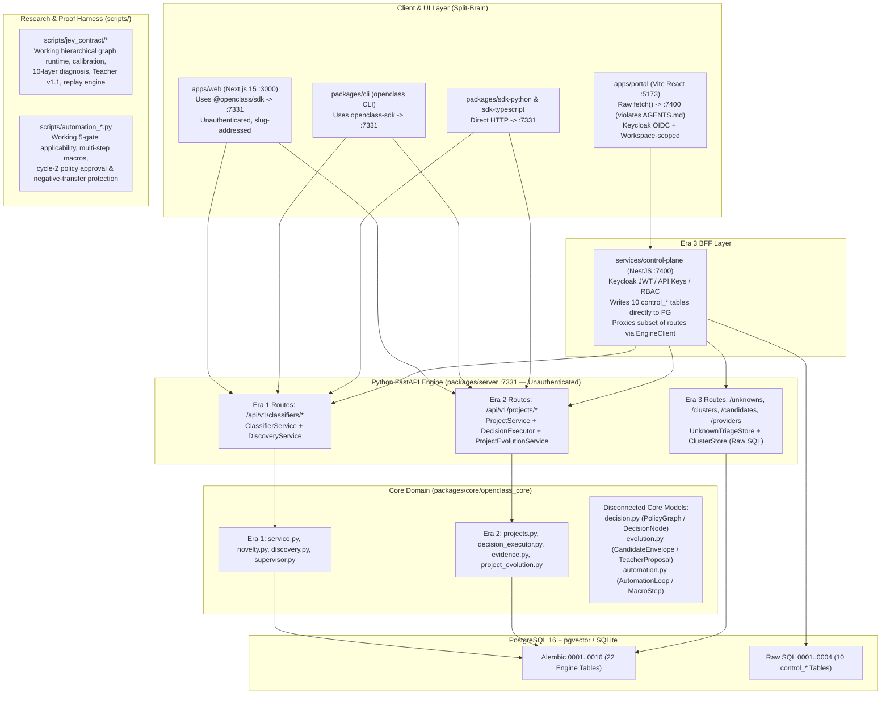

# 01 — Current System Map & Specification Reconciliation

> **Owner:** Abdelhamid Khaled (`AbdelhamidKhald`)  
> **Repository:** `https://github.com/yassincodes404/OpenClass`  
> **Branch:** `abdelhamid-khaled/docs/agentic-harness-audit`  
> **Scope:** Complete architectural map, ownership boundaries, runtime dataflows, and 3-era specification reconciliation.

---

## 1. Executive Architectural Diagnosis: Three Split-Brain Eras in One Checkout

Inspection of the repository reveals that `OpenClass` is not a single uniform v0.0.1 system. Instead, **three distinct architectural eras coexist in the same checkout**, partially overlapping and partially contradicting one another:

### 1.1 The Three Eras Defined

| Era | Governing Documents | Primary Code Surfaces | Primary Abstractions | Current Operational Reality |
| :--- | :--- | :--- | :--- | :--- |
| **Era 1: Genesis Classifier (`v0.0.1`)** | `AGENTS.md`, `docs/architecture/SPECIFICATION.md`, `docs/architecture/genesis.md`, `docs/contributing/tickets.md` (`OC-001`..`OC-032`) | `packages/core/openclass_core/{models,service,novelty,supervisor,discovery}.py`, `packages/server/openclass_server/api/{classifiers,reviews,discovery}.py`, `apps/web/app/page.tsx` | `Classifier`, `OntologyVersion`, `OntologyClass`, `Observation`, `ClassificationRun`, `UnknownEvent`, `CandidateClass` | Working single-label classifier with `UNKNOWN`, advisory `Supervisor` review (`mock` only by default), candidate discovery (`mock`/`glm`), and append-only ontology snapshots. Replay evaluation (`OC-008`) and candidate approval (`OC-009`) are intentionally hard-blocked with `409 evaluation_unavailable`. |
| **Era 2: Project Decision Engine & Jev/Automation Research (`OC-033`)** | `docs/contributing/tickets.md` (`OC-033`), `docs/architecture/jev-native-decision-model.md`, `docs/architecture/teacher-protocol-v1.1.md`, `docs/guides/automation-proof2.md` | `packages/core/openclass_core/{projects,decision_executor,evidence,project_evolution,integrations,analytics}.py`, `apps/web/app/projects/**`, `scripts/jev_contract/**`, `scripts/automation_*.py` | `Project`, `RawEvent`, `DecisionServiceSpec`, `DecisionRun`, `EvidenceItem`, `EvidenceCase`, `ProjectChoiceCandidate`, plus disconnected `PolicyGraph` (`decision.py`), `CandidateEnvelope` (`evolution.py`), `AutomationLoop` (`automation.py`) | Flat single-node `DecisionServiceSpec` works in `apps/web` and `packages/server`, and supports choice candidate creation, deterministic substring replay (`evaluate_choice_candidate`), and promotion (`promote_choice_candidate`). However, multi-node `PolicyGraph` (`decision.py`), `CandidateEnvelope` (`evolution.py`), and `AutomationLoop` (`automation.py`) are **100% disconnected** from server persistence and HTTP APIs, while their working implementations live inside `scripts/jev_contract/` and `scripts/automation_*.py`. |
| **Era 3: Enterprise Portal & Control Plane (`Phase 01`..`Phase 20`)** | `docs/OpenClass_Product_Experience_Platform_Spec.md`, `docs/OpenClass_Master_Product_Technical_Specification_v1.0.docx`, `docs/phases/phase-01..20` | `apps/portal/src/**` (Vite `:5173`), `services/control-plane/src/**` (NestJS `:7400`), `packages/server/openclass_server/api/{unknowns,clusters,candidates,providers}.py`, `persistence/{unknown_triage,cluster_store}.py` | `Workspace`, `ControlProject`, `UnknownTriage`, `UnknownCluster`, `ClusterCandidate`, `ProjectProviderConfig` | Phases 01–10 were partially scaffolded (`apps/portal` + `services/control-plane` + engine migrations `0011`..`0016`), then Phases 11–20 were halted when `docs/architecture/foundation-hardening.md` declared a scope freeze—leaving two incompatible frontends, two database migration systems, and four competing unknown/evolution tracks. |

---

## 2. Package & Service Ownership Inventory

### 2.1 Python Workspace (`pyproject.toml` + `uv.lock`)

| Package / Directory | Role & Intended Boundary | Actual Key Modules | Architectural Boundary Violations & Gaps |
| :--- | :--- | :--- | :--- |
| `packages/core/openclass_core` | Pure domain models, ports, and deterministic domain services. Must not import server, adapters, SDKs, or UI. | `models.py`, `service.py`, `novelty.py`, `supervisor.py`, `discovery.py`, `projects.py`, `decision.py`, `decision_executor.py`, `evidence.py`, `evolution.py`, `project_evolution.py`, `automation.py`, `embeddings.py`, `clustering.py`, `unknown_pool.py`, `integrations.py`, `analytics.py`, `providers.py`, `repositories.py` | Clean of upward imports (`test_boundaries.py`), **but** suffers severe internal duplication: 3 decision models (`ClassifierService`, `DecisionServiceSpec`, `PolicyGraph`), 3 candidate models (`CandidateClass`, `ProjectChoiceCandidate`, `CandidateEnvelope`), and hardcoded provider names (`"laya"`, `"jev"`) inside `DecisionExecutor._supervise` (`decision_executor.py:182-196`). |
| `packages/server/openclass_server` | FastAPI HTTP boundary, SQLAlchemy persistence, Alembic migrations (`0001`..`0016`), rate limiting, redaction, and runtime composition. | `main.py`, `settings.py`, `provider_config.py`, `automation_executor.py`, `integration_adapters.py`, `embeddings_local.py`, `rate_limit.py`, `redaction.py`, `security.py`, `api/*.py`, `persistence/*.py` | - Completely unauthenticated (`security.py` is a 17-line regex helper). - `api/candidates.py:42-151`, `api/clusters.py`, and `api/unknowns.py` bypass `openclass_core` services and execute raw SQL directly inside FastAPI route handlers. - `UnknownTriageStore.append_audit` (`unknown_triage.py:85-102`) writes malformed JSON into `audit_events`, crashing `GET /audit` and `GET /summary`. |
| `providers/mock` | Deterministic local simulation for classification, decisions, discovery, diagnosis, and supervision. | `openclass_provider_mock/__init__.py` | `MockChoiceTeacher` (`project_evolution.py:30-112`) and `MockClusterDiscoveryProvider` (`candidates.py:49-83`) live inside `openclass_core` instead of `providers/mock`. |
| `providers/jev` | Constrained structured JSON decision adapter (`llama.cpp` / OpenAI-compatible HTTP). | `openclass_provider_jev/__init__.py` | Ignores `DecisionServiceSpec.instructions` and `Observation.metadata`; omits `real_inference: True` and `execution_mode: "api"` metadata keys (`__init__.py:102-120`), causing `DecisionExecutor` to misrecord live runs as `real_inference=False, execution_mode="daemon"`. |
| `providers/laya` | Local in-process or daemon sub-500ms classifier/choice provider. | `openclass_provider_laya/{__init__,profile,status}.py` | Regex fallback (`_local_fallback_choice`, `__init__.py:251`) sets `"simulated": False`; `_normalize_response` (`__init__.py:280-287`) silently renormalizes uncalibrated outputs instead of rejecting invalid probability distributions; ignores custom service instructions. |
| `providers/glm` | OpenAI-compatible Teacher, Failure Diagnosis, Discovery, Jev Classifier, and Laya Rerank adapters. | `openclass_provider_glm/{__init__,diagnosis,project_teacher}.py` | Excluded from `pyproject.toml:42` mypy files list; `OpenAICompatibleDiagnosisProvider` (`diagnosis.py:86-93`) silently coerces invalid LLM diagnosis categories to `ANALYTICAL_GAP`; `project_teacher.py:121-122` leaks raw `str(exc)` in `ProviderError`. |
| `providers/ollama` & `providers/openai-compatible` | Documented local and cloud provider packages. | `README.md` only (no `pyproject.toml`, no Python source files). | Placeholder directories only; actual OpenAI-compatible logic lives inside `providers/glm`. |
| `packages/sdk-python` | Synchronous/async HTTP SDK for Python consumers and CLI. | `openclass_sdk/__init__.py` | Calls non-existent `POST /api/v1/projects/{id}/evidence-cases/{cid}/evidence` (`L466`); sends `note` instead of `rationale` on `transition_evidence` (`L442`); missing 15 server routes (analytics, audit, unknown triage, clusters, cluster candidates, providers). |
| `packages/cli` | `openclass` Typer CLI (`init`, `serve`, `classify`, `unknowns`, `discover`, `candidates`, `approve`, `ontology`, `export`, `project *`). | `openclass_cli/main.py` | Only covers 16 of 50 server endpoints; lacks commands for decision service creation/execution, evidence triage, diagnosis, candidate promotion, and integrations. |
| `packages/tui` | Terminal UI inspector. | `packages/tui/README.md` only. | Unimplemented placeholder (`OC-013`). |

### 2.2 TypeScript / Node Workspace (`package.json` + `pnpm-workspace.yaml`)

| Package / Directory | Role & Intended Boundary | Actual Key Modules | Architectural Boundary Violations & Gaps |
| :--- | :--- | :--- | :--- |
| `packages/sdk-typescript` (`@openclass/sdk`) | Typed HTTP client for TypeScript consumers and UIs. | `src/index.ts`, `src/index.test.ts` | - `ingestEventsBatch` (`src/index.ts:573`) types return as `Promise<RawEvent[]>` when server returns `{ items: RawEvent[] }`, breaking `apps/web` batch ingestion UI. - `attachEvidenceToCase` (`src/index.ts:800`) hits non-existent `POST .../evidence-cases/{cid}/evidence` (404). - Missing 14 Phase 05–10 engine routes. |
| `apps/web` (`@openclass/web`) | Next.js 15 App Router workspace (`:3000`). | `app/page.tsx` (Genesis classifier workbench) + `app/projects/**` (7 project tabs: Overview, Data, Services, Playground, Evolution, Integrations, Analytics). | Uses `@openclass/sdk` directly against `:7331`. Unauthenticated. Broken batch upload message (`data/page.tsx:173,229`) and dead `"Add to case"` action (`evolution/page.tsx:303`) due to SDK/API mismatches. |
| `apps/portal` (`@openclass/portal`) | Vite + React 19 SPA (`:5173`) built for Phases 01–10. | `src/portal.tsx`, `src/api.ts`, `src/auth.tsx`, `src/styles.css` | - **Direct `AGENTS.md` violation**: `apps/portal/src/api.ts:10-25` uses raw `fetch()` against `:7400` and never imports `@openclass/sdk`. - Missing capabilities that already work in `apps/web`: no Decision Services editor, no Evidence Cases / Teacher Diagnosis UI, no Integrations management, no Analytics charts. |
| `services/control-plane` (`@openclass/control-plane`) | NestJS 10 BFF & multi-tenant governance layer (`:7400`). | `src/{auth,workspace,project,security,ingestion,decision,unknown,cluster,candidate,portal}.controller.ts`, `src/engine.ts`, `migrations/0001..0004.sql` | - Shares PostgreSQL `public` schema with `packages/server` via raw SQL migrations outside Alembic. - `callerOf(request)` (`ingestion.controller.ts:26-32`) drops `keyProjectId`, breaking all `oc_...` API key calls. - Proxies to `:7331` with zero auth headers or workspace isolation (`engine.ts:274-301`). |

---

## 3. Specification Authority & Contradiction Matrix

The table below reconciles every major architectural contradiction across the repository's specifications and code:

| ID | Topic | Source A Claim | Source B Claim | Actual Code Reality | Resolution Strategy |
| :--- | :--- | :--- | :--- | :--- | :--- |
| **CONTRA-01** | **Frontend & BFF Stack** | `docs/architecture/foundation-hardening.md:20-29`: *"Do not introduce NestJS, migrate Next.js to Vite, add Keycloak, or create parallel product surfaces during foundation hardening."* | `docs/OpenClass_Product_Experience_Platform_Spec.md:145-210` & `docs/phases/phase-01..10`: Mandate Vite `apps/portal` (`:5173`), NestJS `services/control-plane` (`:7400`), and Keycloak OIDC (`:8080`). | **Both stacks exist in the checkout.** Root `package.json:7` sets `"dev": "pnpm --filter @openclass/portal dev"`, while `Makefile:28` runs Playwright against `apps/web` (`:3000`). Projects created in `apps/web`/CLI/SDK do not exist in `control_projects` and are invisible in `apps/portal`. | Designate **one canonical product architecture**: unify the engine + control-plane data model (single source of truth for projects/workspaces) and consolidate the best capabilities of `apps/portal` (auth, workspaces, unknown clustering) and `apps/web` (Decision Services, Teacher Diagnosis, Replay Evaluation, Integrations, Analytics) behind `@openclass/sdk`. |
| **CONTRA-02** | **SDK-Only UI Rule** | `AGENTS.md:8` & `SPECIFICATION.md:45`: *"SDKs speak HTTP only. UI and CLI use SDKs."* | `apps/portal/package.json` does not depend on `@openclass/sdk`. | `apps/portal/src/api.ts:10-25` uses raw `fetch()` to call NestJS control-plane endpoints (`:7400`). | Extend `@openclass/sdk` to support authenticated workspace/project headers and replace raw `fetch()` in `apps/portal/src/api.ts` with `@openclass/sdk`. |
| **CONTRA-03** | **Unknown & Evolution Pipeline** | `SPECIFICATION.md` & `README.md`: Single governed loop `UNKNOWN → EVIDENCE → DISCOVERY → EVALUATION → HUMAN REVIEW → VERSIONED EVOLUTION`. | `docs/phases/phase-07..10` vs `OC-033` vs `jev-native-decision-model.md`. | **Four separate, non-interoperating pipelines** exist in code: 1. Classifier `unknown_events` → `candidates` (`discovery.py`, blocked at 409). 2. Portal `unknown_triage` → `unknown_clusters` → `cluster_candidates` (`api/candidates.py`, blocked at 409). 3. Project `evidence_items` → `evidence_cases` → `project_choice_candidates` (`project_evolution.py`, working substring replay + promotion!). 4. Core `PolicyGraph` → `FailureDiagnosis` → `CandidateEnvelope` (`decision.py` + `evolution.py`, unwired to server). | Unify Tracks 2, 3, and 4 into a single project-scoped **Evidence → Clustering/Triage → Teacher Proposal (`CandidateEnvelope`) → Provider-Backed Replay Evaluation → Human Approval → Versioned Promotion** pipeline. |
| **CONTRA-04** | **Default Decision Provider** | `.env.example:2` & `settings.py:13`: `OPENCLASS_DECISION_PROVIDER=mock` in `.env.example`, `laya` in `settings.py:13`. | `docker-compose.yml:40`: `OPENCLASS_DECISION_PROVIDER: laya` (while `laya` package is not installed in `Dockerfile`!). | When `Settings()` is instantiated without env overrides (e.g., in `tests/integration/test_reviews.py:96`), `decision_provider` defaults to `"laya"`, which fails unless `allow_fallback` is used or `mock` is injected. | Standardize safe local/test default in `settings.py` to `"mock"` (or explicit `"laya"` only when configured) and align `.env.example`, `docker-compose.yml`, and `Dockerfile`. |
| **CONTRA-05** | **Semantic Embeddings & `pgvector`** | `docs/phases/phase-08-embeddings-clustering.md:14-35`: Local `sentence-transformers` (`all-MiniLM-L6-v2`) + `pgvector` cosine similarity search. | `0001_genesis.py:17` & `main.py:168-172`: Require PostgreSQL `vector` extension for `/health/ready`. | `embeddings_local.py:18-52` uses a deterministic SHA-256 token hash (`HashLexicalEmbedder`); `SentenceTransformerEmbedder` (`L55-68`) raises `ProviderError("unsupported")`! And `0015_embeddings_clusters.py:23` stores vectors in `sa.JSON()`, never using `pgvector`. | Implement real embedding adapter support (OpenAI-compatible / local ONNX or `sentence-transformers` optional extra) and store vectors in a `pgvector` column on PostgreSQL (with JSON fallback on SQLite). |
| **CONTRA-06** | **Package Manager & Build Commands** | `AGENTS.md:20` & `README.md:94`: Mention `npm run build` / `npm ci`. | `package.json` & `pnpm-workspace.yaml`: Use `pnpm@9.15.4` workspace protocol (`workspace:*`). | Running `npm ci` fails on `workspace:*` dependencies in `apps/web/package.json:12`; `pnpm install` and `pnpm build` succeed. | Update `README.md`, `Makefile`, and `docs/guides/development.md` to document `pnpm` while keeping root `package.json` scripts compatible with `npm run build` once installed. |

---

## 4. Ticket (`OC-001`..`OC-033`) & Phase (`Phase 01`..`20`) Audit

### 4.1 Ticket Status Audit (`docs/contributing/tickets.md`)

| Ticket Range | Title / Domain | Claimed Status in Docs | True Verified Status in Code | Evidence |
| :--- | :--- | :--- | :--- | :--- |
| **OC-001 .. OC-006** | Core Models, Novelty, FastAPI Server, SQLite/PG Persistence, Mock/Jev/Laya Adapters, Supervisor | Foundation Complete | **Implemented & Verified** (with defects in Jev/Laya provenance & Supervisor wiring) | `packages/core/openclass_core/{models,service,novelty,supervisor}.py`, `providers/{mock,jev,laya}`. Note: `provider_config.py:54-56` only wires `MockSupervisorProvider`. |
| **OC-007** | Discovery Proposal Generation | Implemented | **Partially Implemented** | `packages/core/openclass_core/discovery.py:25-78` proposes `CandidateClass` records (`PENDING`, `evaluation_passed=False`), capped at newest 200 unknowns (`L28`). |
| **OC-008** | Replay Evaluation Engine | Open / Gate | **Split**: Blocked in `discovery.py:80-108` (`EvaluationUnavailableError`), Implemented (substring heuristic) in `project_evolution.py:310-370`, Implemented (full empirical gate) in `scripts/jev_contract/runtime.py:194-244`. | `api/discovery.py` and `api/candidates.py:130-151` always return `409 evaluation_unavailable`. |
| **OC-009** | Candidate Approval & Ontology Promotion | Open / Gate | **Split**: Blocked in `discovery.py:92-108` and `api/candidates.py:141-151` (`409`), Implemented in `project_evolution.py:372-498` (`promote_choice_candidate`). | `project_evolution.py:372-498` creates `OntologyVersion` `vN+1` and appends choice to `DecisionServiceSpec`, though across non-atomic DB sessions. |
| **OC-010 .. OC-012** | Python SDK, TypeScript SDK, CLI | Foundation Complete | **Partially Implemented (Contract Drift)** | Both SDKs have 404/schema bugs on evidence routes (`sdk-python/__init__.py:466`, `sdk-typescript/src/index.ts:573,800`) and miss 14–15 newer routes. |
| **OC-013** | Terminal UI (`packages/tui`) | Planned | **Documented but Absent** | Only `packages/tui/README.md` exists. |
| **OC-014 .. OC-025** | Provider Contracts, Benchmarks, Hidden Intents, Self-Expansion Proofs | Research Complete | **Experimental / Research-Only** | Lives in `scripts/` and `benchmarks/`; 6 current `pytest` failures/errors on Windows & default settings. |
| **OC-026 .. OC-032** | Jev Contract v2.1, Calibration, Hierarchical Graph, Teacher v1.1, Automation Proofs #2 & #2B | Research Complete | **Disconnected Core / Script-Only** | Domain types copied into `decision.py`, `evolution.py`, `automation.py`, but runtime execution remains in `scripts/jev_contract/` and `scripts/automation_*.py`. |
| **OC-033** | Project Workspace, Raw Events, Decision Services, Evidence & Integrations | Implemented | **Partially Implemented (Critical Bugs)** | `projects.py`, `decision_executor.py`, `evidence.py`, `project_evolution.py`, `integrations.py`. Suffers from instruction-drop bug (`decision_executor.py:58-85`), single-node execution (`L38-50`), and SSRF (`integration_adapters.py:89-126`). |

### 4.2 Portal Phase Audit (`docs/phases/phase-01` .. `phase-20`)

| Phase | Title | True Status | Reality in Codebase |
| :--- | :--- | :--- | :--- |
| **Phase 01** | Portal Foundation (`apps/portal`, `services/control-plane`) | **Implemented & Verified** | `apps/portal` + `services/control-plane` health/topology endpoints. |
| **Phase 02** | Identity, Auth & Workspaces | **Implemented (with API Key Bug)** | Keycloak OIDC + `0001_identity.sql`. API key auth broken by `callerOf()` dropping `keyProjectId` (`ingestion.controller.ts:26-32`). |
| **Phase 03** | Projects & Classifiers | **Implemented (Split-Brain)** | `0002_projects.sql` + `project.service.ts`. Global vs workspace slug collisions (`0002_projects.sql:6,18`). |
| **Phase 04** | Security, Keys, Rate Limits, Redaction, Audit | **Partially Implemented** | `0003_security.sql`. Retention policy is dead config; engine redaction settings are unwired (`settings.py:19-20`). |
| **Phase 05** | Event Ingestion & Deduplication | **Implemented** | `0011_idempotency_keys.py`, `0012_raw_event_content_hash.py`. Idempotency store lacks request-hash check (`idempotency.py:24-61`). |
| **Phase 06** | Decision Execution & Provider Governance | **Partially Implemented** | `0013_provider_usage.py`, `0004_provider_configs.sql`. Provider usage daily rollup drops distinct models (`tables.py:300`). |
| **Phase 07** | Unknown Workspace & Triage | **Implemented (with Crash Bug)** | `0014_unknown_triage.py`, `api/unknowns.py`. `UnknownTriageStore.append_audit` (`unknown_triage.py:85-102`) corrupts `audit_events` and crashes `/audit` and `/summary` with HTTP 500! |
| **Phase 08** | Embeddings & Unknown Clustering | **Mock / Simulated** | `0015_embeddings_clusters.py`, `api/clusters.py`. Uses `HashLexicalEmbedder` JSON arrays (`embeddings_local.py:18-52`), not semantic embeddings or `pgvector`. Re-clustering cascade-deletes all `cluster_candidates`! |
| **Phase 09** | Discovery & Candidate Creation | **Partially Implemented** | `0016_cluster_candidates.py`, `api/candidates.py`. Hardcodes `MockClusterDiscoveryProvider` (`api/candidates.py:42`). |
| **Phase 10** | Candidate Review & Readiness Gates | **Stubbed Gate (HTTP 409)** | `api/candidates.py:130-151` always returns `409 evaluation_unavailable`. |
| **Phase 11** | Replay & Evaluation Engine | **Documented but Absent** (in Portal track) | Spec in `docs/phases/phase-11-replay-evaluation-engine.md`; zero Phase 11 tables or endpoints exist. |
| **Phase 12** | Promotion & Ontology Versioning | **Documented but Absent** (in Portal track) | Spec in `docs/phases/phase-12-promotion-ontology-versioning.md`; unimplemented in `api/candidates.py`. |
| **Phase 13** | Monitoring, Drift & Rollback | **Documented but Absent** | Spec in `docs/phases/phase-13-monitoring-drift-rollback.md`; no drift detection or rollback routes exist. |
| **Phase 14** | Public SDKs & CLI Completion | **Partially Implemented** | Spec in `docs/phases/phase-14-public-sdks-cli.md`; SDKs/CLI lack Phase 05–13 parity. |
| **Phase 15** | Demo Seed & Interactive Sandbox | **Partially Implemented** | `scripts/seed_portal_phase_01..10.py` exist; landing sandbox is static. |
| **Phase 16** | Support Integrations (Zendesk, Intercom, Freshdesk, Crisp, HelpScout) | **Documented but Absent** | Only generic webhook + GET health probe exist (`integration_adapters.py`); no vendor normalizers, HMAC signatures, or write-back rules. |
| **Phase 17** | Billing, Plans & Quotas | **Documented but Absent** | Spec in `docs/phases/phase-17-billing-plans-quotas.md`; zero billing/quota code exists. |
| **Phase 18** | Observability, SLOs & Operations | **Documented but Absent** | Spec in `docs/phases/phase-18-observability-slos-ops.md`; no OpenTelemetry/Prometheus metrics exist. |
| **Phase 19** | Security Hardening & Compliance | **Documented but Absent** | Spec in `docs/phases/phase-19-security-hardening-compliance.md`. |
| **Phase 20** | Release Candidate (`v0.1.0-rc1`) | **Documented but Absent** | Spec in `docs/phases/phase-20-release-candidate.md`. |
