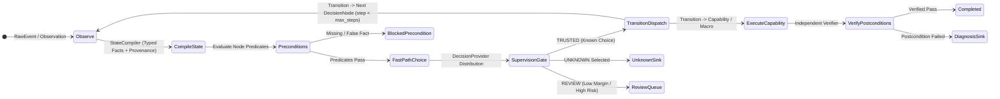

# 03 — Deep Assessment: Agentic Engineering & The OpenClass Agentic Harness

> **Owner:** Abdelhamid Khaled (`AbdelhamidKhald`)  
> **Scope:** Comprehensive technical evaluation of (I) **Agentic Engineering** (how OpenClass is built, tested, and verified) and (II) **OpenClass's Product Agentic Harness** across all 9 architectural dimensions (`6A`–`6I`).

---

## Part I: Agentic Engineering Assessment (How OpenClass Is Developed & Verified)

Agentic Engineering concerns the methodology, repository structure, verification harnesses, and guardrails that allow human and AI engineers to evolve OpenClass without regressions or architectural drift.

### 1.1 Strengths of the Current Engineering Harness
1. **Strict Inward Dependency Enforcement (`tests/unit/test_boundaries.py`)**:
   - AST-level unit tests verify that `openclass_core` never imports `openclass_server`, `openclass_sdk`, `openclass_cli`, or `providers/*`, and that `providers/*` never import `openclass_server`.
2. **Explicit Contract & Adversarial Response Testing (`tests/contract/`)**:
   - Provider adapters (`jev`, `laya`, `glm`, `mock`) are tested against malformed JSON, HTTP 5xx, empty choices, unnormalized probabilities, and secret-redaction checks using deterministic `httpx.MockTransport` harnesses.
3. **Research Proof Discipline (`scripts/jev_contract/`, `scripts/automation_*.py`, `benchmarks/`)**:
   - Complex hypotheses (Jev 2–32 choice scaling, temperature/margin calibration, 10-layer failure attribution, multi-step port-conflict recovery macros, and negative-transfer gate rejection) were empirically proven with hash-verified artifacts before attempting server integration.

### 1.2 Critical Weaknesses in the Current Engineering Harness
1. **Shortcut & Mocked Tests Masking Real Cross-Boundary Breakages**:
   - **SDK/UI Mock Drift**: `packages/sdk-typescript/src/index.test.ts:163-165` and `tests/web/data.spec.ts:98-110` mock `POST /events/batch` returning a bare array `[{...}]` (`200`/`201`), whereas the real FastAPI endpoint (`api/projects.py:137-198`) returns `207 Multi-Status` with `{"items": [...]}`. Because Playwright (`tests/web/*.spec.ts`) stubs 100% of `/api/v1/*` calls with `page.route(...)` and never boots `openclass_server`, the broken batch upload in `apps/web/app/projects/[id]/data/page.tsx:168-173` went undetected.
   - **Fake SQL Pool in Control-Plane Tests**: All 10 NestJS spec files (`services/control-plane/src/*.spec.ts`) match SQL queries using `text.startsWith("INSERT INTO ...")` against an in-memory mock and never apply `services/control-plane/migrations/0001..0004.sql` to PostgreSQL. And `ingestion.service.spec.ts` called `IngestionService` directly with a hand-crafted `caller` object, missing that `IngestionController.callerOf(request)` (`ingestion.controller.ts:26-32`) drops `keyProjectId` and breaks every API key request over HTTP!
   - **Audit Deserialization Blind Spot**: `tests/integration/test_unknown_workspace.py` tests `/unknowns/{id}/triage` and `/unknowns/stats`, but never calls `/audit` or `/summary` afterward—missing that `UnknownTriageStore.append_audit` (`unknown_triage.py:85-102`) corrupts the `audit_events` table and crashes both endpoints with HTTP 500.
2. **Research-to-Production Chasm (`scripts/` vs `packages/core` & `packages/server`)**:
   - 9 of 27 unit test files in `tests/unit/` prepend `scripts/` to `sys.path` and test standalone research scripts (`scripts/jev_contract/*`, `scripts/decision_graph*.py`, `scripts/automation_*.py`) while the production classes in `packages/core/openclass_core/{decision,evolution,automation}.py` remain either unintegrated data models or simplified stubs with regressions.
3. **Broken CI Pipelines & Cross-Platform Fragility**:
   - `.github/workflows/ci.yml:56-62` and `Makefile:4` invoke `npm ci` on a workspace that uses `pnpm` `"workspace:*"` specifiers (`apps/web/package.json:12`).
   - `.github/workflows/ci.yml:38` runs `tests/integration/test_raw_events_postgres.py:59-60`, which still expects HTTP `201` on `/events/batch` instead of `207`.
   - 6 `pytest` tests fail or error on Windows due to 2MB parametrized test IDs overflowing `PYTEST_CURRENT_TEST` (`test_jev_provider.py`, `test_supervisor_provider.py`), CRLF byte hashing (`test_automation_reuse.py:142` — no `.gitattributes`), Windows `SO_REUSEADDR` socket semantics (`test_automation_reuse.py:160`), and `Settings.decision_provider = "laya"` default (`test_reviews.py:96`, `test_decision_executor.py:95`).

---

## Part II: Deep Assessment of the Product's Agentic Harness (Sections 6A–6I)

### 6A. Orchestration and Execution Lifecycle



#### Current State & Concrete Evidence
- **Two Disconnected Runtime Loops**:
  1. `DecisionExecutor.execute` (`packages/core/openclass_core/decision_executor.py:25-198`): Production executor wired to `POST /api/v1/projects/{id}/decision-services/{sid}/runs` (`api/decisions.py:67-155`). It is strictly **single-node and synchronous**:
     - Always selects `node = service.nodes[0]` (`decision_executor.py:38-50`) unless an explicit `node_id` is passed, and performs **zero graph transitions**.
     - Generates ephemeral `uuid4()` identifiers for `OntologyClass.stable_class_id`, `OntologyVersion.id`, and `Observation.id` on every single invocation (`decision_executor.py:58-80`), destroying cross-run class lineage.
     - Drops `service.instructions` and `node.instructions` when building `ChoiceRequest(observation=..., ontology=...)` (`decision_executor.py:58-85`), even though `DecisionRun.instructions_snapshot` (`L164`) records `node.instructions` as if it were sent to the model.
  2. `PolicyGraph` (`packages/core/openclass_core/decision.py:130-330`) vs `scripts/jev_contract/runtime.py:89-192` and `scripts/decision_graph.py:196-339`:
     - `decision.py` defines `PolicyGraph`, `DecisionNode`, `Transition`, `TransitionTargetKind` (`NODE`, `CAPABILITY`, `MACRO`, `HUMAN`, `TERMINAL`), and `NodeConstraint` (`max_choices: int = 16`).
     - However, `decision.py` has **no graph executor class in `packages/core`**. The actual multi-node loop with cycle detection (`visited_nodes`), step budgets (`max_steps = 8`), and transition dispatch only exists in `scripts/jev_contract/runtime.py:101-192`.
- **Missing Lifecycle States**:
  - There is no durable run state machine (`PENDING`, `RUNNING`, `WAITING_APPROVAL`, `PAUSED`, `COMPLETED`, `FAILED`, `CANCELLED`, `TIMED_OUT`). Runs only exist in the database after synchronous completion (`decision_runs` table, `0006`).

#### Target Design
- Promote the multi-hop graph execution loop from `scripts/jev_contract/runtime.py:101-192` into `DecisionExecutor` in `packages/core/openclass_core/decision_executor.py`, unified over versioned `PolicyGraph` / `DecisionServiceVersion` snapshots.
- Persist a step-by-step `DecisionStepTrace` array (`step_index`, `node_id`, `compiled_state_hash`, `probabilities`, `selected_choice`, `margin`, `supervision_outcome`, `transition_target`, `latency_ms`) and support durable `WAITING_HUMAN` / `PAUSED` checkpoints with resume tokens.

---

### 6B. State Compilation, Context, and Memory

#### Current State & Concrete Evidence
- **Predicate Evaluation Bug in Core (`packages/core/openclass_core/decision.py:217-235`)**:
  - `evaluate_predicates` (`decision.py:226-227`) checks:
    ```python
    actual = state.facts.get(predicate.field)
    if actual != predicate.equals:
        return False
    ```
  - **Defect 1 (Missing vs `None`)**: If `predicate.field` is absent from `state.facts` and `predicate.equals` is `None`, `state.facts.get(field)` returns `None == None` (`True`), conflating an unprobed/missing fact with `None`.
  - **Defect 2 (`bool` vs `int` coercion in Python)**: In Python, `True == 1` and `False == 0` evaluate to `True`! Thus a predicate expecting `equals=1` matches `actual=True`.
  - Ironically, `scripts/jev_contract/runtime.py:90-98` fixed both bugs (`if pred.field not in state.facts: return False` and `if isinstance(actual, bool) != isinstance(pred.equals, bool): return False`), but the fix was never ported to `packages/core/openclass_core/decision.py`!
- **Metadata & State Dropped at Runtime (`decision_executor.py:58-65`)**:
  - `RawEvent` (`projects.py:132-146`) stores structured `metadata: dict[str, Any]`, and `POST /runs` (`api/decisions.py:72`) accepts `metadata`. Yet `DecisionExecutor.execute` (`decision_executor.py:58-65`) only passes `content` into `Observation` and providers (`providers/jev/__init__.py:102`, `providers/laya/__init__.py:139`) only read `request.observation.content`, ignoring `observation.metadata` completely.
- **Five-Plane Memory Separation**:
  - Currently, only transient single-step input (`input_snapshot`), raw runs (`decision_runs`), and evidence items (`evidence_items`) are separated. There is no `StateCompiler` service in `packages/core` that compiles raw events + prior node outputs + integration probes into a schema-validated `StateSnapshot` with per-fact provenance (`source`, `observed_at`, `verified: bool`) and token/byte budget enforcement before provider invocation.

#### Target Design
- Fix `evaluate_predicates` in `packages/core/openclass_core/decision.py:217-235` to enforce explicit key presence (`field in state.facts`) and strict type identity (`type(actual) is type(predicate.equals)`).
- Introduce `StateCompiler` in `packages/core/openclass_core/decision.py` that compiles `RawEvent.content`, `RawEvent.metadata`, and prior step outputs against `StateSchema`, enforces field byte/token caps, and serializes structured facts + node instructions into `ChoiceRequest`.

---

### 6C. Decision Execution and Provider Adapters

#### Current State & Concrete Evidence
- **Critical Tie-Breaking Bug Violating `UNKNOWN` Permanence (`packages/core/openclass_core/decision_executor.py:102-115`)**:
  - In `DecisionExecutor.execute`:
    ```python
    full_probs: dict[str, float] = {}
    for c in node.choices:
        full_probs[c.key] = max(0.0, float(raw_probs.get(c.key, 0.0)))
    full_probs[UNKNOWN_CHOICE_KEY] = max(0.0, float( response.unknown_probability ))
    ...
    ranked = sorted(full_probs.items(), key=lambda kv: kv[1], reverse=True)
    selected_choice, top_prob = ranked[0]
    ```
  - Because Python's `timsort` is stable and `node.choices` are inserted into `full_probs` **before** `UNKNOWN_CHOICE_KEY`, whenever a known choice and `UNKNOWN` tie for highest probability (e.g., `0.50` vs `0.50`), `ranked[0]` selects the **known choice** instead of `UNKNOWN`!
  - By contrast, `select_choice` in `packages/core/openclass_core/decision.py:291-299` explicitly checks `if unknown_prob >= best_prob or margin < policy.min_margin: return UNKNOWN_CHOICE`.
- **Hardcoded Provider Supervision Logic (`decision_executor.py:169-197`)**:
  - `DecisionExecutor._supervise` branches on literal provider names (`if provider_name == "laya": return "REVIEW", ...` and `if provider_name == "jev": ...`), violating Core provider neutrality (`AGENTS.md`) and ignoring `SupervisionPolicy.max_unknown_probability` and `DecisionNode.risk_level`.
- **Provider Provenance & Validation Defects**:
  - `JevDecisionProvider` (`providers/jev/openclass_provider_jev/__init__.py:102-120`) does not set `"real_inference": True` or `"execution_mode": "api"` in `provider_metadata`, so `DecisionExecutor` (`L142-146`) records every live Jev inference as `real_inference=False, execution_mode="daemon"`.
  - `LayaDecisionProvider._local_fallback_choice` (`providers/laya/openclass_provider_laya/__init__.py:251`) sets `"simulated": False` on deterministic regex fallback output, violating `AGENTS.md` (*"Keep mock output clearly marked as simulated"*).
  - `LayaDecisionProvider._normalize_response` (`__init__.py:280-287`) silently divides unnormalized numbers by their sum instead of rejecting invalid probability distributions (`abs(total - 1.0) > 0.05`).

---

### 6D. Capabilities, Tools, Macros, and Independent Verification

#### Current State & Concrete Evidence
- **`AutomationLoop` Is Broken on Macros (`packages/core/openclass_core/automation.py:51-58, 120-138`)**:
  - `AutomationDecision.action` (`automation.py:54`) is typed as `AutomationActionName` (a fixed 7-value `StrEnum`: `INSPECT_PORT`, `CHOOSE_AVAILABLE_TEST_PORT`, `SET_ENVIRONMENT`, `RUN_TESTS`, `RERUN_PREVIOUS`, `WRITE_REPORT`, `DONE`, `BLOCKED`).
  - In `AutomationLoop.step()` (`automation.py:120-128`), `policy.choose(state)` returns an `AutomationDecision` **before** `if decision.action in self.policy.macros:` (`L123`) is checked! Any macro name (such as `"recover_port_conflict"`) raises a Pydantic `ValidationError` on `AutomationDecision` construction.
  - Even if constructed, `AutomationLoop.step()` never iterates through `macro.steps`—it passes `decision.action` directly to `self.executor.execute(decision.action, state)` (`L129`).
  - `state = state.model_copy(update=result.state_patch)` (`L132`) bypasses Pydantic validation and injects undeclared attributes (`test_port`) onto `AutomationState`.
- **`SafeSandboxExecutor` Is Unwired and Unsafe (`packages/server/openclass_server/automation_executor.py:21-105`)**:
  - Never imported anywhere in `packages/server/openclass_server/api/*` or `main.py`.
  - Executes `subprocess.run([sys.executable, "-m", "pytest", ...])` (`L65-72`) with **no `timeout=` parameter** (an infinite loop hangs the worker forever) and buffers all `stdout`/`stderr` in memory.
  - Environment filtering (`{k: v for k, v in os.environ.items() if not k.endswith("API_KEY")}`, `L63`) leaks `OPENCLASS_DATABASE_URL`, `AWS_SECRET_ACCESS_KEY`, and webhook tokens to child processes.
  - `INSPECT_PORT` (`L35-48`) allows probing arbitrary localhost TCP ports (`1..65535`).
  - 4 of 8 enum actions (`SET_ENVIRONMENT`, `RERUN_PREVIOUS`, `DONE`, `BLOCKED`) fall through to `raise ValueError(f"Unsupported action: {action}")` (`L104`).
- **Research vs. Core Gap (`scripts/automation_*.py`)**:
  - Working multi-step macro expansion, 5-gate macro applicability (`schema_match`, `precondition_match`, `failure_signature_match`, `capability_availability`, `guard_compatibility`), attempt budgets, and independent socket/file postcondition verification exist in `scripts/automation_applicability.py`, `scripts/automation_attempts.py`, and `scripts/automation_proof2b_cycle2.py`, but have not been ported to `packages/core`.

---

### 6E. Teacher, Supervisor, and Failure Diagnosis

#### Current State & Concrete Evidence
- **Supervisor Only Wired to Mock (`packages/server/openclass_server/provider_config.py:54-56`)**:
  - `build_supervisor_provider` only supports `"mock"`. Setting `OPENCLASS_SUPERVISOR_PROVIDER` to anything else raises `ValueError`.
- **Startup Crash & Silent Fallback in `provider_config.py:95-125`**:
  - Setting `OPENCLASS_DISCOVERY_PROVIDER=openai-compatible` without `OPENCLASS_DISCOVERY_BASE_URL` passes `base_url=""` to `GLMDiscoveryProvider` (`provider_config.py:95-99`), which raises `ValueError("base_url must not be empty")` during `create_app()` startup.
  - Conversely, `build_diagnosis_provider` (`provider_config.py:118-119`) silently falls back to `RuleBasedDiagnosisProvider` when `OPENCLASS_DIAGNOSIS_API_KEY` is unset, masking misconfiguration.
- **Silent Enum Coercion & Error Leakage in `providers/glm`**:
  - `OpenAICompatibleDiagnosisProvider` (`providers/glm/openclass_provider_glm/diagnosis.py:86-93`) catches `ValueError` on invalid LLM category strings and silently substitutes `DiagnosisCategory.ANALYTICAL_GAP` instead of raising `ProviderError("malformed_response")`.
  - `OpenAICompatibleChoiceTeacher.propose` (`providers/glm/openclass_provider_glm/project_teacher.py:121-122`) catches `Exception as exc` and raises `ProviderError(f"Teacher request failed: {exc}")`, leaking raw `httpx` exception text (including internal URLs/headers).
- **Prompt Injection in Discovery & Diagnosis Prompts**:
  - `GLMDiscoveryProvider.discover` (`providers/glm/openclass_provider_glm/__init__.py:35-58`) and `OpenAICompatibleDiagnosisProvider.diagnose` (`diagnosis.py:53-77`) interpolate raw untrusted `observation` text and user-supplied `instructions` into LLM prompts without untrusted-data boundary instructions or character caps.

---

### 6F. Discovery, Clustering, and Controlled Evolution

#### Current State & Concrete Evidence
- **Four Fractured Candidate & Evolution Pipelines**:
  1. Legacy `DiscoveryService` (`discovery.py:15-94`, `candidates` table `0003`) — slices only the newest 200 unknowns (`L28`); `evaluate` and `approve` raise `ConflictError` (HTTP 409).
  2. Project `ProjectEvolutionService` (`project_evolution.py:101-257`, `project_choice_candidates` table `0007`) — supports only 3 `ProposalKind`s (`new_choice`, `existing_choice`, `insufficient_evidence`); rejects `READY_FOR_EVOLUTION` evidence from `LOW_TRUST` or `HUMAN_CORRECTION` runs (`L118`); `evaluate` and `promote` raise `ConflictError` (HTTP 409); `reject` has **no HTTP route** in `api/evolution.py`!
  3. Portal Cluster Discovery (`candidates.py:1-186`, `api/candidates.py:1-225`, `cluster_candidates` table `0016`) — raw SQL inside FastAPI routes, hardcoded `MockClusterDiscoveryProvider` (`api/candidates.py:30`), and **cascading data loss** whenever `POST /unknowns/cluster` is re-run (`cluster_store.py:50-53` deletes `unknown_clusters`, cascading to `cluster_candidates` and `candidate_evidence`).
  4. Core Graph/Automation Evolution (`evolution.py:1-248`: `FailureLayer`, `TeacherProposal`, `CandidateEnvelope`) — zero tables, zero repositories, zero routes.
- **Unversioned `DecisionService` Mutation (`persistence/project_repository.py:230-246`)**:
  - `DecisionServiceRow` (`tables.py:133-147`) is updated in-place with no `decision_service_versions` table and no append-only SQL trigger.

---

### 6G. Evaluation, Benchmarking, and Regression Protection

#### Current State & Concrete Evidence
- **Zero Evaluation Persistence in `packages/server`**:
  - No tables exist for `evaluation_datasets`, `evaluation_examples`, `evaluation_runs`, or `candidate_approvals`.
  - Both `DiscoveryService.evaluate` (`discovery.py:76-79`) and `ProjectEvolutionService.evaluate` (`project_evolution.py:204-206`) unconditionally raise `ConflictError("Verified replay evaluation is not implemented")`.
- **Unreproducible Benchmark Audit Script (`scripts/jev_contract/audit.py:27,76,80`)**:
  - `benchmarks/jev-contract/v1/knowledge.json` references evidence files inside gitignored `build/...` directories, causing `uv run python -m scripts.jev_contract.audit` to fail with `FileNotFoundError` on any clean clone.

---

### 6H. Reliability, Security, Governance, and Observability

#### Current State & Concrete Evidence
1. **`UnknownTriageStore.append_audit` Permanent 500 Crash (`persistence/unknown_triage.py:85-102`)**:
   - Inserts `{"target": target}` into `audit_events.payload` with event types (`unknown.triaged`, `unknown.transitioned`, `cluster.updated`, `candidate.created`) missing from `ProjectAuditEvent.event_type` (`projects.py:78-101`). Subsequent calls to `GET /api/v1/projects/{id}/audit` or `GET /api/v1/projects/{id}/summary` crash with `500 Internal Server Error`.
2. **Critical SSRF & Arbitrary Env-Var Exfiltration (`integration_adapters.py:25-37, 89-126`)**:
   - `EnvironmentSecrets.resolve` resolves any uppercase env var in `os.environ` (`OPENCLASS_JEV_API_KEY`, `AI_GATEWAY_API_KEY`, etc.), and `HTTPIntegrationProbe.check` sends it as `Authorization: Bearer <secret>` to any user-supplied `endpoint` URL without blocking private IPs, `169.254.169.254`, or external attacker domains.
3. **Unauthenticated Python Engine & Broken Control-Plane API Keys (`ingestion.controller.ts:26-32`)**:
   - `packages/server` has zero authentication on `/api/v1/*`.
   - In `services/control-plane/src/ingestion.controller.ts:26-32`, `callerOf(request)` drops `keyProjectId`, causing all `oc_...` API key calls to fail with `404 Workspace not found`.
   - `IngestionService.ingest` (`ingestion.service.ts:79,116`) only checks `"viewer"` role instead of `"operator"`.
4. **Rate Limiter, Idempotency & Webhook Dedup Bugs**:
   - `RateLimiter.route_class` (`rate_limit.py:44-49`) throttles `GET /events` and `GET /runs` against write budgets while leaving `POST .../webhook` unthrottled.
   - `SQLIntegrationRepository.ingest_webhook` (`integration_repository.py:53-94`) crashes with `409 Conflict` when two different `event_key` deliveries share identical message text.
   - `IdempotencyStore` (`idempotency.py:24-61`, `idempotency.service.ts:16-33`) never validates the incoming request body hash and never refreshes expired keys due to `ON CONFLICT DO NOTHING`.

---

### 6I. Product Surface and Developer Experience

#### Current State & Concrete Evidence
- **Dual Incompatible Frontends (`apps/web` vs `apps/portal` + `services/control-plane`)**:
  - `apps/web` (Next.js `:3000`) talks directly to `packages/server` (`:7331`) via `@openclass/sdk`. It implements Decision Services, Playground, Evidence Cases, Teacher Diagnosis, Candidate Proposals, Integrations, and Analytics.
  - `apps/portal` (Vite `:5173`) talks to `services/control-plane` (`:7400`) via raw `fetch()` (`apps/portal/src/api.ts:10-25`, violating `AGENTS.md`). It implements Keycloak Auth, Workspaces, API Keys, Unknown Triage, and Unknown Clusters, but lacks Decision Services, Evidence Cases, Integrations, and Analytics.
  - Projects created via `apps/web`, CLI, or SDKs do not exist in `control_projects` and are invisible in `apps/portal`.
- **Broken SDK & UI Routes**:
  - Both SDKs (`sdk-python/__init__.py:466`, `sdk-typescript/src/index.ts:800`) and `apps/web/app/projects/[id]/evolution/page.tsx:303` call `POST /api/v1/projects/{id}/evidence-cases/{cid}/evidence`, which **does not exist on the server** (404).
  - `transition_evidence` in both SDKs (`sdk-python/__init__.py:442`, `sdk-typescript/src/index.ts:773`) sends `{"status": ..., "note": ...}`, while the server (`api/schemas.py:240`) expects `{"status": ..., "rationale": ...}` (`note` is silently dropped).
  - `ingestBatch` in `@openclass/sdk` (`src/index.ts:573`) returns `{ items: [...] }` typed as `RawEvent[]`, breaking `apps/web/app/projects/[id]/data/page.tsx:173,229`.
