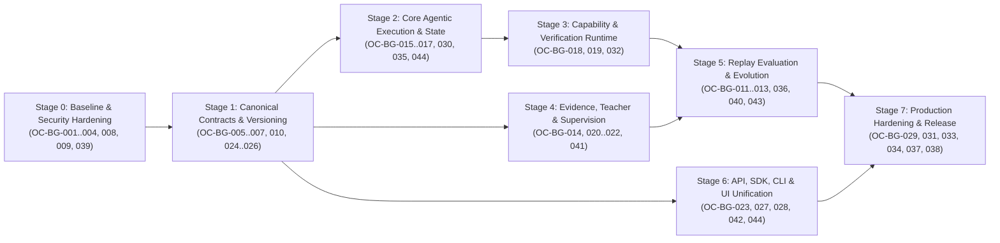

# 05 — Dependency-Ordered Execution Roadmap & First 10 Tasks

> **Owner:** Abdelhamid Khaled (`AbdelhamidKhald`)  
> **Scope:** 8-stage dependency-ordered implementation roadmap, parallelization strategy, and surgical blueprints for the First 10 Highest-Value Implementation Tasks.

---

## 1. Dependency-Ordered 8-Stage Execution Roadmap

### Stage-by-Stage Breakdown (Aligned with `docs/implementation-phases/01..10` & `OC-034`..`OC-045`)

| Stage       | Name                                                                                                     | Entry Criteria                                                                                                                                   | Backlog Items Included                                                                    | Alignment with `docs/implementation-phases/01..10` & Tickets                                                                                        | Parallel Workstreams                                                                                                                                                                                                                          | Exit Criteria & Verification Gate                                                                                                                                                                                                                                                                                                                                                                                                                                                                          |
| :---------- | :------------------------------------------------------------------------------------------------------- | :----------------------------------------------------------------------------------------------------------------------------------------------- | :---------------------------------------------------------------------------------------- | :-------------------------------------------------------------------------------------------------------------------------------------------------- | :-------------------------------------------------------------------------------------------------------------------------------------------------------------------------------------------------------------------------------------------- | :--------------------------------------------------------------------------------------------------------------------------------------------------------------------------------------------------------------------------------------------------------------------------------------------------------------------------------------------------------------------------------------------------------------------------------------------------------------------------------------------------------- |
| **Stage 0** | **Baseline Stabilization, Critical Bug Fixes & Security Emergency Hardening**                            | Current checkout (`abdelhamid-khaled/docs/agentic-harness-audit` with `feat/portal-phase-17` `3ab10ea` & `oc-034-ci-baseline` `ef525ea` merged). | `OC-BG-001`, `OC-BG-002`, `OC-BG-003`, `OC-BG-004`, `OC-BG-008`, `OC-BG-009`, `OC-BG-039` | • `01-verify-ci-baseline.md` (`OC-034`, `OC-040`) • `02-wire-provider-integrations.md` (`OC-035`)                                               | • **Track A (Python Test & Persistence Fixes):** `OC-BG-001`, `OC-BG-002`, `OC-BG-008` (`0023`), `OC-BG-009`, `OC-BG-039` • **Track B (Security & Control-Plane Fixes):** `OC-BG-003`, `OC-BG-004`                                        | • `uv run pytest -q` passes with **0 failures, 0 errors** on Windows & Linux (`main.py:237` duplicate `support_router` removed, ambient `.env` isolated). • `GET /audit` and `GET /summary` return `200 OK` after unknown triage/clustering/evaluation/alerting (all 10 event types valid). • `oc_...` API keys authenticate on `IngestionController`. • SSRF & arbitrary env-var exfiltration blocked in `HTTPIntegrationProbe`. • Re-clustering preserves `cluster_candidates` (`0023`). |
| **Stage 1** | **Canonical Domain Contracts, Instruction Propagation & Immutable Versioning**                           | Stage 0 green.                                                                                                                                   | `OC-BG-005`, `OC-BG-006`, `OC-BG-007`, `OC-BG-010`, `OC-BG-024`, `OC-BG-025`, `OC-BG-026` | • `03-close-the-learning-loop.md` (`OC-036` versioning & alias foundation)                                                                          | • **Track A (Core & Provider Contracts):** `OC-BG-005`, `OC-BG-006` • **Track B (DB Versioning & Transactions):** `OC-BG-010` (`0020` + `0024`), `OC-BG-024`, `OC-BG-025`, `OC-BG-026` • **Track C (SDK/API Alignment):** `OC-BG-007` | • Custom `DecisionService` instructions reach `Jev` and `Laya` prompts. • `service_versions` (`0020` + `0024`) is append-only with DB triggers and preserves `aliases` in `DecisionChoiceSpec`. • Tie-breaking selects `UNKNOWN`; `evaluate_predicates` handles missing vs `None` and `bool` vs `int`. • TS SDK `ingestBatch`, `attachEvidenceToCase`, `transition_evidence`, and `/reject` pass integration tests.                                                                            |
| **Stage 2** | **Core Agentic Execution Loop, Multi-Node `PolicyGraph` & `StateCompiler`**                              | Stage 1 green (`0024` migrated).                                                                                                                 | `OC-BG-015`, `OC-BG-016`, `OC-BG-017`, `OC-BG-030`, `OC-BG-035`, `OC-BG-044`              | • `05-harden-fast-path-inference.md` (`OC-038`) • `06-graduate-multi-step-graphs.md` (`OC-045`)                                                 | • **Track A (Graph Executor & StateCompiler):** `OC-BG-015`, `OC-BG-016`, `OC-BG-035` (`0026`), `OC-BG-044` (`0027`) • **Track B (Calibration & SQL Pagination):** `OC-BG-017`, `OC-BG-030`                                               | • `DecisionExecutor` traverses multi-node `PolicyGraph`s (`max_steps=8`, cycle detection), persists `DecisionStepTrace`, and enforces atomic CAS checkpoint claiming (`0026` + `0027`). • `StateCompiler` compiles `RawEvent.metadata` and enforces field schemas. • `SupervisionPolicy` replaces hardcoded `"laya"`/`"jev"` branches.                                                                                                                                                             |
| **Stage 3** | **Capability Runtime, Macro Expansion, Sandbox Hardening & Independent Verification**                    | Stage 2 green.                                                                                                                                   | `OC-BG-018`, `OC-BG-019`, `OC-BG-032`                                                     | • `08-automate-bounded-actions.md` • `09-integrate-external-webhooks.md`                                                                        | • **Track A (Core Automation & Verifiers):** `OC-BG-018` • **Track B (Sandbox & Outbox):** `OC-BG-019`, `OC-BG-032` (`0022`)                                                                                                              | • `AutomationLoop` validates and expands multi-step macros with 5-gate applicability checks and independent postcondition verifiers. • `SafeSandboxExecutor` enforces timeouts, output caps, and env allowlists.                                                                                                                                                                                                                                                                                       |
| **Stage 4** | **Evidence Ledger Unification, Pluggable Embeddings, Teacher v1.1 & Real Supervisor**                    | Stage 1 green (can run in parallel with Stages 2–3).                                                                                             | `OC-BG-014`, `OC-BG-020`, `OC-BG-021`, `OC-BG-022`, `OC-BG-041`                           | • `02-wire-provider-integrations.md` (`OC-035`, `OC-042`) • `03-close-the-learning-loop.md` (`OC-036`) • `07-attribute-complex-failures.md` | • **Track A (Embeddings & Unified Candidates):** `OC-BG-014` (`0017`), `OC-BG-022`, `OC-BG-041` • **Track B (Supervisor & Teacher v1.1):** `OC-BG-020`, `OC-BG-021`                                                                       | • `unknown_triage` and `evidence_items` are synchronized. • Cluster discovery routes through `ProjectEvolutionService` / `GatewayClusterDiscovery` using configured Teacher. • Real LLM `SupervisorProvider` and `TeacherProposal` (`apply_candidate`) wired in `provider_config.py`.                                                                                                                                                                                                              |
| **Stage 5** | **Verified Replay Evaluation, Regression Gates & Controlled Promotion (`OC-008` / `OC-009` / `OC-036`)** | Stages 1, 2, and 4 green.                                                                                                                        | `OC-BG-011`, `OC-BG-012`, `OC-BG-013`, `OC-BG-036`, `OC-BG-040`, `OC-BG-043`              | • `03-close-the-learning-loop.md` (`OC-036`) • `04-prove-the-learning-loop.md` (`OC-037`, `OC-041`, `OC-044`)                                   | • **Track A (Evaluation Datasets & Real Replay Engine):** `OC-BG-011` (`0018` + `0025`), `OC-BG-012` (`0019`), `OC-BG-040` • **Track B (Transactional Promotion & Drift):** `OC-BG-013` (`0020`), `OC-BG-036` (`0021`), `OC-BG-043`       | • Sealed human-verified datasets reject `"prediction"` labels (`0025`) and block discovery-to-holdout leakage (`409`). • `api/evaluations.py` replaces hardcoded `MockDecisionProvider()` with real `DecisionExecutor` baseline vs. candidate replay (`simulated=False`) with Teacher disabled. • Human approval promotes `vN → vN+1` under `SELECT ... FOR UPDATE`, preserves `aliases`, resolves linked evidence, and fixes the `two_weeks_ago` upper-bound bug in `api/operations.py`.          |
| **Stage 6** | **API, SDK, CLI & Dual-Frontend Unification**                                                            | Stages 1 and 5 green.                                                                                                                            | `OC-BG-023`, `OC-BG-027`, `OC-BG-028`, `OC-BG-042`, `OC-BG-044`                           | • `09-integrate-external-webhooks.md` • `10-ship-verified-release.md` (`OC-039`, `OC-043`, `OC-045`)                                            | • **Track A (Internal Auth & Tenant Isolation):** `OC-BG-023`, `OC-BG-044` (`0027`) • **Track B (SDK/CLI 100% Parity & Portal/Web Unification):** `OC-BG-027`, `OC-BG-028`, `OC-BG-042`                                                   | • `apps/portal` uses `@openclass/sdk` (zero raw `fetch`). • Projects created via SDK/CLI/Web and Portal share a unified registry with strict workspace ownership (`0027`). • Python SDK, TS SDK, and CLI cover 100% of server routes (including Phases 11–16 `/evaluations`, `/promotions`, `/alerts`, `/analytics/trends`, `/support`, `/routes`, `/claim`).                                                                                                                                      |
| **Stage 7** | **Observability, Full-Stack E2E Verification & Release Readiness (`v0.1.0-rc1` / `OC-039`)**             | Stages 3, 5, and 6 green.                                                                                                                        | `OC-BG-029`, `OC-BG-031`, `OC-BG-033`, `OC-BG-034`, `OC-BG-037`, `OC-BG-038`              | • `04-prove-the-learning-loop.md` (`OC-037`) • `05-harden-fast-path-inference.md` (`OC-038`) • `10-ship-verified-release.md` (`OC-039`)     | • **Track A (Observability & Security Polish):** `OC-BG-029`, `OC-BG-031` • **Track B (Full-Stack E2E, Docker & Release):** `OC-BG-033`, `OC-BG-034`, `OC-BG-037`, `OC-BG-038`                                                            | • `make check`, `make test`, PostgreSQL integration suite, Control-Plane Postgres suite, and live-backend Playwright E2E suite pass 100%. • Second-cycle live application proof (`OC-037` / `OC-BG-040`) verifies closed-loop evolution with zero regressions. • `docker compose --profile test run test` and `uv build --all-packages` succeed cleanly.                                                                                                                                           |

---

## 2. First 10 Highest-Value Implementation Tasks (Ready for Immediate Execution)

These 10 tasks deliver the highest immediate engineering leverage by eliminating all remaining Windows/Linux test discrepancies, removing the duplicate `support_router` mount, fixing critical security vulnerabilities (`SSRF`, secret exfiltration, broken API key auth), fixing the HTTP 500 audit log crash across all 10 uninscribed event types, restoring instruction propagation, and hardening the newly merged `0017`..`0022` evaluation/promotion/versioning tables with real `DecisionExecutor` replay and alias preservation.

### Task 1: Make Test Suite & CI 100% Green Across Windows, Linux & PostgreSQL (`OC-BG-001` + `OC-BG-039` / `OC-034` + `OC-040`)

- **Branch:** `abdelhamid-khaled/fix/test-suite-and-ci-parity`
- **Context:** `origin/oc-034-ci-baseline` (`ef525ea`) verified Linux CI (`403 passed, 13 skipped` locally; `413 passed, 3 skipped` with Postgres; `50/50` Playwright specs on run `37051177668`), and `feat/portal-phase-17` (`3ab10ea`) already updated `.github/workflows/ci.yml` to `pnpm`. These edits close the remaining Windows failures, unmarked Postgres/live tests, `.github/workflows/artifacts.yml`, and the duplicate `support_router` in `main.py`.
- **Exact Edits:**
  1. `packages/server/openclass_server/main.py:200,237`: Remove the duplicate `app.include_router(support_router)` at line `237` (`OC-BG-039`).
  2. `tests/contract/test_jev_provider.py:86` & `tests/contract/test_supervisor_provider.py:72`: Add `ids=["truncated_json", "wrong_type", "oversized_2mb"]` to `@pytest.mark.parametrize` so 2MB strings are not placed into `PYTEST_CURRENT_TEST`.
  3. `tests/integration/test_reviews.py:96`: Pass `decision_provider=MockDecisionProvider()` to `create_app(...)`.
  4. `tests/unit/test_decision_executor.py:95`: Assert `real_run.execution_mode in {"in_process", "deterministic_test_fallback"}` when `laya` is not installed, or inject a deterministic stub router.
  5. `tests/unit/test_automation_reuse.py:142,160` & `.gitattributes`: Normalize CRLF before SHA-256 comparison, add `.gitattributes` (`* text=auto eol=lf`), and use `socket.SO_EXCLUSIVEADDRUSE` on Windows in `scripts/automation_transfer_fixture.py`.
  6. `tests/integration/test_raw_events_postgres.py:59-60`: Update expected status from `201` to `207` and `len(resp.json()["items"]) == 2`. Add `pytestmark = pytest.mark.postgres` to all 6 unmarked `test_*_postgres.py` files and `pytest.mark.live` to `tests/contract/test_gemini_live.py`.
  7. `.github/workflows/artifacts.yml`: Add `pnpm/action-setup@v4` and replace `npm ci` with `pnpm install --frozen-lockfile`.

### Task 2: Fix `UnknownTriageStore.append_audit` HTTP 500 Crash Across All 10 Event Types (`OC-BG-002`)

- **Branch:** `abdelhamid-khaled/fix/audit-event-deserialization`
- **Exact Edits:**
  1. `packages/core/openclass_core/projects.py:78-101`: Add all 10 Portal/triage/evaluation/alerting event types (`"unknown.triaged"`, `"unknown.transitioned"`, `"cluster.updated"`, `"candidate.created"`, `"candidate.updated"`, `"candidate.rejected"`, `"evaluation.dataset_created"`, `"evaluation.dataset_sealed"`, `"evaluation.completed"`, `"quality.alert"`) to `ProjectAuditEvent.event_type`.
  2. `packages/server/openclass_server/persistence/unknown_triage.py:86-110`: Construct a valid `ProjectAuditEvent` and serialize `event.model_dump(mode="json")` into `audit_events.payload`.
  3. `packages/server/openclass_server/persistence/project_repository.py:116-123`: Add defensive fallback in `SQLProjectRepository.audit_events` for any historical row whose `payload` lacks `"id"`.

### Task 3: Fix Control-Plane API Key Authorization (`callerOf`), Scopes & RBAC (`OC-BG-003`)

- **Branch:** `abdelhamid-khaled/fix/control-plane-apikey-auth`
- **Exact Edits:**
  1. `services/control-plane/src/ingestion.controller.ts:26-32`: Include `keyProjectId: request.keyProjectId` and `keyScopes: request.keyScopes` in `callerOf(request)`.
  2. `services/control-plane/src/ingestion.service.ts:45-55, 79, 116`: Check `"read"` scope for `GET` and `"ingest"` scope for `POST`; require `"operator"` minimum role (instead of `"viewer"`) in `ingest` and `ingestBatch`.
  3. `services/control-plane/src/decision.controller.ts:58`: Allow `oc_...` API keys with `"classify"` scope.

### Task 4: Eliminate SSRF & Arbitrary Env-Var Exfiltration (`OC-BG-004`)

- **Branch:** `abdelhamid-khaled/fix/ssrf-and-secret-isolation`
- **Exact Edits:**
  1. `packages/server/openclass_server/security.py`: Implement `validate_outbound_url(url: str)` blocking loopback, RFC1918 private IPs, link-local (`169.254.0.0/16`), multicast, and internal container hostnames after DNS resolution.
  2. `packages/server/openclass_server/integration_adapters.py:29-35, 89-126`: Restrict `EnvironmentSecrets.resolve` to `OPENCLASS_INTEGRATION_SECRET_*` prefix, call `validate_outbound_url(endpoint)`, and set `follow_redirects=False`.
  3. `packages/server/openclass_server/api/providers.py:15,29-42` & `provider_config.py`: Remove plaintext `api_key` from `ProviderConfigPayload`, restrict `api_key_env` prefix, and validate `base_url` via `validate_outbound_url`.

### Task 5: Propagate `DecisionService` & `DecisionNode` Instructions to Providers (`OC-BG-005`)

- **Branch:** `abdelhamid-khaled/fix/instruction-propagation`
- **Exact Edits:**
  1. `packages/core/openclass_core/models.py:109-120`: Add `instructions: str | None = None` to `ChoiceRequest`.
  2. `packages/core/openclass_core/decision_executor.py:58-85, 164`: Pass `instructions = node.instructions or service.instructions` into `ChoiceRequest` and `DecisionRun.instructions_snapshot`.
  3. `packages/core/openclass_core/projects.py:665-678`: Update `service.nodes[0].instructions` when `service.instructions` is updated on a single-node service.
  4. `providers/jev/openclass_provider_jev/__init__.py:102` & `providers/laya/openclass_provider_laya/__init__.py:139,193`: Include `request.instructions` in the provider request payload.

### Task 6: Fix `DecisionExecutor` Tie-Breaking, Stable UUIDs & `evaluate_predicates` (`OC-BG-006`)

- **Branch:** `abdelhamid-khaled/fix/core-decision-invariants`
- **Exact Edits:**
  1. `packages/core/openclass_core/decision_executor.py:58-80, 102-125`: Select `UNKNOWN` whenever `unknown_prob >= top_known_prob` (fixing tie-breaking); derive deterministic `uuid5` identifiers for `OntologyClass.stable_class_id` and `OntologyVersion.id`.
  2. `packages/core/openclass_core/decision.py:217-235`: Check `if predicate.field not in state.facts: return False` and `if isinstance(actual, bool) != isinstance(predicate.equals, bool): return False` in `evaluate_predicates`.

### Task 7: Fix SDK, Server & Web Contract Drift (`OC-BG-007`)

- **Branch:** `abdelhamid-khaled/fix/sdk-api-contract-alignment`
- **Exact Edits:**
  1. `packages/sdk-typescript/src/index.ts:573-582`: Unwrap `.items.map((i) => i.event)` in `ingestBatch`.
  2. `packages/server/openclass_server/api/evidence.py` & `projects.py`: Add `POST /api/v1/projects/{identifier}/evidence-cases/{case_id}/evidence` and accept `note` as alias for `rationale` in `TransitionEvidenceRequest` (`api/schemas.py:240`).
  3. `packages/server/openclass_server/api/evolution.py`: Add `POST /api/v1/projects/{identifier}/candidates/{candidate_id}/reject` (or unify with `/api/v1/projects/{identifier}/unknowns/candidates/{candidate_id}/reject` from `0017`).

### Task 8: Prevent Re-Clustering Cascade Data Loss (`0023`) & Fix Provider Config/Provenance (`OC-BG-008` + `OC-BG-009` / `OC-035`)

- **Branch:** `abdelhamid-khaled/fix/cluster-cascade-and-provider-provenance`
- **Exact Edits:**
  1. `packages/server/openclass_server/persistence/cluster_store.py:45-53`, `tables.py:344` & migration `0023_preserve_cluster_candidates.py`: Change `cluster_candidates.cluster_id` FK to `ondelete="SET NULL"` (`nullable=True`) so re-clustering never deletes discovered candidates or `candidate_reviews` (`0017`).
  2. `providers/jev/openclass_provider_jev/__init__.py:115`: Add `"real_inference": True, "simulated": False, "execution_mode": "api"`.
  3. `providers/laya/openclass_provider_laya/__init__.py:251,280-287`: Set `"simulated": True` in `_local_fallback_choice` and reject distributions where `abs(total - 1.0) > 0.05`.
  4. `packages/server/openclass_server/provider_config.py:95-125`: Validate required `base_url` and API keys explicitly without crashing on `""` or silently falling back on missing diagnosis key, and reconcile the unmerged `artifacts/application-proofs/scikit-learn-2026-10-02/provider-wiring.patch` cleanly (`OC-035`).

### Task 9: Harden `service_versions` (`0020` + `0024`) with Append-Only Triggers, Alias Preservation & Run Lineage (`OC-BG-010` + `OC-BG-039` / `OC-017` + `OC-040`)

- **Branch:** `abdelhamid-khaled/feat/decision-service-versioning`
- **Exact Edits:**
  1. `packages/core/openclass_core/projects.py:157-168` & `promotion.py`: Add `aliases: tuple[str, ...] = ()` to `DecisionChoiceSpec` and update `persistence/promotion_store.py:160` (`_sync_project_Repository_choices`) and `api/promotions.py:148-157` so promoted aliases are preserved in `decision_services.payload` and `service_versions`.
  2. Create Alembic migration `0024_decision_run_version_lineage.py` adding `decision_service_version_id` and `service_hash` columns to `decision_runs`, widening PostgreSQL `alembic_version.version_num` (`OC-BG-039`), plus PostgreSQL/SQLite append-only triggers (`BEFORE UPDATE` / `BEFORE DELETE`) on `service_versions` (`0020`).
  3. Record `decision_service_version_id` and `service_hash` on every `DecisionRun` and emit `decision_service.*` `ProjectAuditEvent`s.

### Task 10: Replace Hardcoded `MockDecisionProvider` in `api/evaluations.py` with Real `DecisionExecutor` Replay & Unify Promotion (`OC-BG-011` + `OC-BG-012` + `OC-BG-013` + `OC-BG-040` / `OC-036` + `OC-041`)

- **Branch:** `abdelhamid-khaled/feat/verified-replay-and-promotion`
- **Exact Edits:**
  1. Create migration `0025_evaluation_holdouts_and_provenance.py` adding `label_source`, `verified_by`, `verified_at`, and `split` (`"replay"` | `"holdout"`) to `evaluation_items` (`0018`) and `is_simulated`, `provider`, and `model` to `evaluation_runs` (`0019`).
  2. `packages/server/openclass_server/api/evaluations.py:306,433-452`: Remove the hardcoded `provider = MockDecisionProvider()` and replace `_replay` with real `DecisionExecutor` execution over the project's configured `DecisionProvider` (with Teacher disabled), persisting per-item results (`0019`) with honest `is_simulated` provenance.
  3. Unify `ProjectEvolutionService.evaluate` / `promote` (`project_evolution.py:204-240`), `DiscoveryService.evaluate` / `approve` (`discovery.py:69-79`), and `PromotionStore.promote_candidate` (`promotion_store.py:55-96`) under `SELECT ... FOR UPDATE`, requiring a passing `evaluation_run_id`, creating `service_versions` (`0020`) `vN+1`, and resolving linked `EvidenceItem`s.

---

## 3. Post-PR #27–#55 Execution & Partial-Scope Reconciliation

All 8 roadmap stages (`Stage 0` through `Stage 7`) and the First 10 Tasks were executed across **PRs #27 – #55** (including **PR #51** `5a5542f` offline CI test remediation, **PR #52** `66505e5` durable graph checkpoints `0026_decision_run_checkpoints.py`, **PR #53** `81e2127` Portal migration onto `OpenClassControlClient` + project reconciliation + landing consistency, **PR #54** rigorous closed-loop evolution proof + documentation reconciliation, and **PR #55** end-to-end workspace ownership + atomic CAS checkpoint claiming `0027_workspace_isolation_and_checkpoint_claims.py`).

To keep the roadmap strictly honest against the shipped codebase and preserve the exact original scope of `OC-BG-001` through `OC-BG-038` while recording additional work delivered during PRs `#29–#55` under separate tickets `OC-BG-039` through `OC-BG-044` (`OC-040`–`OC-045`), **25 of 44 backlog items are `VERIFIED`** (`19` original `OC-BG-001..038` + `6` additional `OC-BG-039..044`) and **19 original items remain `PARTIAL`** where specific acceptance criteria from their original (`7158104`) definitions remain open as follows:

|  Stage  | Backlog ID    |   Status    | Shipped & Verified Scope (PRs #27–#55)                                                                                                                                                                                                                                                                                                                                                                                                                           | Remaining Partial Scope (Under Original `7158104` Ticket Definition)                                                                                                                                                                                                                                                                                                                                                                                                                                               |
| :-----: | :------------ | :---------: | :--------------------------------------------------------------------------------------------------------------------------------------------------------------------------------------------------------------------------------------------------------------------------------------------------------------------------------------------------------------------------------------------------------------------------------------------------------------- | :----------------------------------------------------------------------------------------------------------------------------------------------------------------------------------------------------------------------------------------------------------------------------------------------------------------------------------------------------------------------------------------------------------------------------------------------------------------------------------------------------------------- |
| Stage 1 | **OC-BG-024** | **PARTIAL** | Python `SQLIntegrationRepository.ingest_webhook` (linking duplicate `content_hash` across distinct `event_key`s) and `IdempotencyStore` (`persistence/idempotency.py` `request_hash` validation and expiry refresh) are fixed.                                                                                                                                                                                                                                   | Control-Plane `services/control-plane/src/idempotency.service.ts` still uses `ON CONFLICT (key, workspace_id) DO NOTHING` without refreshing expired keys or verifying `request_hash` on replay.                                                                                                                                                                                                                                                                                                                   |
| Stage 1 | **OC-BG-025** | **PARTIAL** | `SELECT ... FOR UPDATE` / atomic CAS is enforced on promotion and checkpoint resume, and `repository.py` validates `stored.payload`.                                                                                                                                                                                                                                                                                                                             | `evidence_items.decision_run_id` (`tables.py:260`) lacks a `UNIQUE` constraint, and `ProjectService` multi-step mutations (`record_decision_run`, `submit_run_feedback`, `create_evidence_case`, `ingest_events_batch`) still commit across per-method repository sessions rather than a shared Unit-of-Work session.                                                                                                                                                                                              |
| Stage 1 | **OC-BG-026** | **PARTIAL** | `migrations/env.py` filters out `control_*` tables via `include_name`, and `control_projects` uniqueness is scoped to `UNIQUE (workspace_id, slug)`.                                                                                                                                                                                                                                                                                                             | No migration runner script exists for `services/control-plane/migrations/`, and append-only SQL triggers are not added to `observations`, `classification_runs`, `unknown_events`, `run_feedback`, or `control_audit_events`.                                                                                                                                                                                                                                                                                      |
| Stage 2 | **OC-BG-016** | **PARTIAL** | `compile_event_state` in `decision_executor.py:37-58` compiles `RawEvent.metadata` and prior resolved decisions into a `StateSnapshot` with deterministic `snapshot_hash` and `4096`-char truncation, and `DecisionExecutor._score_node` (`L171-314`, `L245-259`) serializes `Structured state facts:` into `ChoiceRequest.instructions` (consumed by `JevDecisionProvider` and `LayaDecisionProvider`).                                                         | No standalone `StateCompiler.compile(raw_event, prior_steps, schema)` in `openclass_core/decision.py` enforcing `StateSchema`/`StateFieldSpec` types or source/freshness provenance, `DecisionServiceNode` does not yet define or enforce `required_state_fields` or `preconditions`, and `state_facts` are not attached to `Observation.metadata`.                                                                                                                                                                |
| Stage 2 | **OC-BG-017** | **PARTIAL** | `DecisionExecutor._supervise` (`decision_executor.py:831-885`) enforces node-level `min_margin`, `max_unknown_probability`, `pause_on_review`, and `DecisionServiceNode.risk_level` (`projects.py:187-196`).                                                                                                                                                                                                                                                     | `DecisionExecutor._supervise` (`L864-879`) still retains hardcoded `if provider_name == "laya":` and `if provider_name == "jev":` fallback threshold branches rather than delegating to `evaluate_supervision(policy, profile, ...)` with runtime ECE-calibrated `OperatingProfile`s.                                                                                                                                                                                                                              |
| Stage 2 | **OC-BG-030** | **PARTIAL** | `api/unknowns.py` (`GET /unknowns`, `limit` `le=500`, `offset`) and `api/clusters.py` (`ClusterRequest.limit` `le=1000`, `scan_limit=1000`) lift the 200-row cap.                                                                                                                                                                                                                                                                                                | `discovery.py:28` and `unknowns.py:46` still pass `limit=200`, and `SQLProjectRepository.analytics_runs` and `ProjectService.summary` still load rows in memory rather than using SQL `COUNT(*)` / `GROUP BY`.                                                                                                                                                                                                                                                                                                     |
| Stage 3 | **OC-BG-018** | **PARTIAL** | `AutomationDecision.action` accepts macro names, `AutomationLoop.step()` validates/expands `AutomationMacro` steps, validates `state_patch` against `allowed_state_fields`, and runs `verifier: AutomationVerifier` on `DONE`.                                                                                                                                                                                                                                   | `ApplicabilitySpec`/`applicable` (`scripts/automation_applicability.py:124-133`) and 5-gate `create_policy_v2` (`scripts/automation_policy_approval.py:33-110`) were not ported into `openclass_core.automation`, and `test_automation_applicability.py` / `test_automation_proof2b_cycle2.py` still import from `scripts/`.                                                                                                                                                                                       |
| Stage 3 | **OC-BG-032** | **PARTIAL** | `HTTPIntegrationProbe.check` probes `REST`, `WEBHOOK`, `MCP` (`tools/list`), `DATABASE`, and `PROVIDER` endpoints with SSRF protection, and `api/support.py` evaluates idempotent `RouteOutcome`s (`delivery_mode="simulated"`).                                                                                                                                                                                                                                 | No transactional `outbound_deliveries` outbox SQL table or background retry worker exists, and vendor webhook HMAC-SHA256 payload normalizers (Zendesk, Intercom, Freshdesk) are not implemented.                                                                                                                                                                                                                                                                                                                  |
| Stage 4 | **OC-BG-014** | **PARTIAL** | `unknown_triage` transitions synchronize with `evidence_items`, `project_evolution.py` accepts `LOW_TRUST`/`HUMAN_CORRECTION` runs, and linked cluster unknowns auto-resolve on promotion.                                                                                                                                                                                                                                                                       | The 4 candidate models/tables (`candidates` in `0003`, `project_choice_candidates` in `0007`, `cluster_candidates` in `0016`, and `CandidateEnvelope` in `evolution.py`) remain separate SQL tables rather than a unified candidate repository, and `ProposalKind` in `packages/core/openclass_core/project_evolution.py:22-25` only defines `NEW_CHOICE`, `EXISTING_CHOICE`, and `INSUFFICIENT_EVIDENCE` (missing `PROMPT_PATCH`, `THRESHOLD_PATCH`, `WORKFLOW_ROUTE_PATCH`, `SPLIT_CHOICE`, and `MERGE_CHOICE`). |
| Stage 4 | **OC-BG-020** | **PARTIAL** | `OpenAICompatibleSupervisorProvider` is implemented and wired for `"glm"`, `"openai-compatible"`, `"ollama"`, and `"gateway"` in `provider_config.py`.                                                                                                                                                                                                                                                                                                           | Automatic post-run supervision triggers (`review_on_low_margin`, `sample_rate`) in `ProjectService.record_decision_run` are not implemented.                                                                                                                                                                                                                                                                                                                                                                       |
| Stage 4 | **OC-BG-021** | **PARTIAL** | `apply_candidate` and 10-layer candidate hash/application across `DECISION_SPACE`, `PROCEDURE`, `STATE_REPRESENTATION`, and `CALIBRATION_SUPERVISION` are promoted into `openclass_core.evolution`.                                                                                                                                                                                                                                                              | `OpenAICompatibleChoiceTeacher` still outputs `ChoiceProposal` (`ProposalKind`: `NEW_CHOICE`, `EXISTING_CHOICE`, `INSUFFICIENT_EVIDENCE`, missing `PROMPT_PATCH`, `THRESHOLD_PATCH`, `WORKFLOW_ROUTE_PATCH`, `SPLIT_CHOICE`, `MERGE_CHOICE`) rather than 10-layer `TeacherProposal`, and `apply_candidate` is unit-tested rather than wired into server evolution HTTP routes.                                                                                                                                     |
| Stage 4 | **OC-BG-022** | **PARTIAL** | `GatewayEmbedder`, `asyncio.to_thread` in `SentenceTransformerEmbedder.embed`, and `ClusterStore.get_cached_embeddings` / `store_embedding` (`(run_id, model)` cache in `0015_embeddings_clusters.py`) are implemented.                                                                                                                                                                                                                                          | `ClusterStore` stores vectors as JSON strings and clusters in Python with greedy cosine similarity rather than `pgvector` cosine distance indexing on PostgreSQL.                                                                                                                                                                                                                                                                                                                                                  |
| Stage 5 | **OC-BG-012** | **PARTIAL** | `api/evaluations.py` and `api/evolution.py` (`POST /candidates/{cid}/evaluate`) run real `DecisionExecutor` baseline vs. candidate replay with Teacher disabled and enforce regression gates (`overall_passed`, `zero_regressions`, `holdout_examples >= 1`).                                                                                                                                                                                                    | Core `ProjectEvolutionService.evaluate` (`project_evolution.py:217`) and `DiscoveryService.evaluate` (`discovery.py:76`, Track 1 `POST /api/v1/classifiers/{slug}/candidates/{cid}/evaluate`) still raise `ConflictError` (`409`), and per-example replay predictions are stored in `evaluation_runs.metrics` JSON (`0019_evaluation_runs.py`, `metrics["item_results"]`) rather than a separate normalized `evaluation_predictions` SQL table.                                                                    |
| Stage 5 | **OC-BG-013** | **PARTIAL** | Track 2 (`POST /api/v1/projects/{id}/candidates/{cid}/promote`) and Track 3 (`POST /api/v1/projects/{id}/discovery-candidates/{cid}/promote`) enforce human approval, passing evaluation (`overall_passed`, `zero_regressions`, `holdout_examples >= 1`), `SELECT ... FOR UPDATE`, key/alias collision rejection (`409`), immutable `service_versions` `vN+1`, rollback (`POST /rollback`), and auto-resolution of linked `evidence_items` and `unknown_triage`. | Legacy Track 1 `DiscoveryService.approve` (`POST /api/v1/classifiers/{slug}/candidates/{cid}/approve` over `0001_genesis` `Classifier` ontology snapshots) remains fail-closed (`409`), and `ProjectEvolutionService.promote` (`project_evolution.py:221`) still raises `ConflictError`.                                                                                                                                                                                                                           |
| Stage 5 | **OC-BG-036** | **PARTIAL** | Phase 15 `alerting.py` (`AlertRule` for `unknown_rate`, `low_margin_rate`, `provider_error_rate` in `0021_alert_rules.py`) and `/alerts/evaluate` are implemented.                                                                                                                                                                                                                                                                                               | No `GET /api/v1/projects/{id}/decision-services/{sid}/drift` cohort drift detector in `analytics.py` or automated post-promotion rollback trigger to parent version `vN` is implemented.                                                                                                                                                                                                                                                                                                                           |
| Stage 6 | **OC-BG-027** | **PARTIAL** | `apps/portal/src/api.ts` uses `@openclass/sdk` (`OpenClassControlClient`) with zero raw `fetch()` calls, and `ProjectService` reconciles workspace-owned engine projects (`0027`, PR #55).                                                                                                                                                                                                                                                                       | `apps/portal` and `apps/web` remain two separate active frontends rather than a single consolidated frontend, and `apps/portal` does not expose Track 2 `EvidenceCase` / multi-node `DecisionService` graph editor views.                                                                                                                                                                                                                                                                                          |
| Stage 7 | **OC-BG-029** | **PARTIAL** | `api/decisions.py` passes actual `provider_name`, `model_name`, and `latency_ms` to `record_provider_error`, and `main.py` preserves HTTP `429` (`rate_limited`) and echoes `X-Correlation-ID`.                                                                                                                                                                                                                                                                  | `uq_provider_usage_day` (`tables.py:214`) still omits `"model"`, `services/control-plane/src/engine.ts` does not forward `X-Correlation-ID`, and embedding/discovery/Teacher costs are not recorded in `provider_usage`.                                                                                                                                                                                                                                                                                           |
| Stage 7 | **OC-BG-033** | **PARTIAL** | `apps/portal/src/portal.test.tsx` includes authenticated component tests, SDK boundary verification, and landing scenario distribution verification, `services/control-plane/src/{engine,project.service}.spec.ts` include cross-workspace isolation tests, and `tests/e2e/test_closed_loop_evolution.py` tests closed-loop evolution.                                                                                                                           | `services/control-plane/src/*.spec.ts` uses an in-memory mocked `pg.Pool` rather than a migrated PostgreSQL instance, and `playwright.config.ts` only runs route-mocked `tests/web/*.spec.ts` without a live-backend Playwright suite.                                                                                                                                                                                                                                                                             |
| Stage 7 | **OC-BG-034** | **PARTIAL** | `scripts.jev_contract.audit` is self-contained on a clean clone, `Dockerfile` copies `benchmarks`, `examples`, `packages/tui`, `providers/ollama`, and `providers/openai-compatible` with non-root `USER openclass`, `pyproject.toml` includes `openclass_provider_glm`, and `scripts/release.py` checks `services/control-plane/package.json`.                                                                                                                  | `docker-compose.yml` only defines `postgres`, `keycloak`, `openclass`, and `test` (no `control-plane`, `portal`, or `web` services), and running `uv run mypy packages providers tests` with bare directory arguments still requires `--explicit-package-bases`.                                                                                                                                                                                                                                                   |

### 3.1 Additional Work Delivered Under Separate Tickets (`OC-BG-039` – `OC-BG-044`)

|   Stage   | Backlog ID    | Ticket ID |    Status    | Delivered Scope                                                                                                                                                                                                                                    |
| :-------: | :------------ | :-------: | :----------: | :------------------------------------------------------------------------------------------------------------------------------------------------------------------------------------------------------------------------------------------------- |
|  Stage 0  | **OC-BG-039** | `OC-040`  | **VERIFIED** | Deduplicated `support_router` mount in `main.py`, isolated offline `pytest` suite from ambient `.env` credentials (`_isolate_provider_env`), and widened PostgreSQL `alembic_version.version_num` (`0024`, PR #29, PR #37, PR #51).                |
|  Stage 5  | **OC-BG-040** | `OC-041`  | **VERIFIED** | Enforced strictly disjoint discovery/dev/regression/holdout datasets, server-side leakage (`409`) and collision (`409`) guards, `discovery_provider="none"`, and offline + live Gateway closed-loop E2E proof (PR #50, PR #54).                    |
|  Stage 4  | **OC-BG-041** | `OC-042`  | **VERIFIED** | Promoted `GatewayDecisionProvider`, `GatewayEmbedder`, and `GatewayClusterDiscovery` into `providers/glm/openclass_provider_glm/gateway.py` and `provider_config.py` with temperature scaling and telemetry (PR #45).                              |
|  Stage 6  | **OC-BG-042** | `OC-043`  | **VERIFIED** | Raised Control-Plane Express JSON limit to `5mb`, fixed `keycloak.init` offline redirect, implemented single-source `deriveScenarioDistribution` in `apps/portal/src/open-world-stage.tsx`, and split `apps/portal` route chunks (PR #44, PR #53). |
|  Stage 5  | **OC-BG-043** | `OC-044`  | **VERIFIED** | Fixed `api/operations.py` disjoint 7-day analytics comparison window (`[two_weeks_ago, week_ago)` vs `[week_ago, now)`) (PR #39).                                                                                                                  |
| Stage 2/6 | **OC-BG-044** | `OC-045`  | **VERIFIED** | Enforced end-to-end engine & control-plane workspace ownership (`0027`, `POST /projects/{id}/claim`), atomic CAS checkpoint claiming before `DecisionExecutor.resume`, crash recovery, and lifecycle-based cancellation (PR #55).                  |
